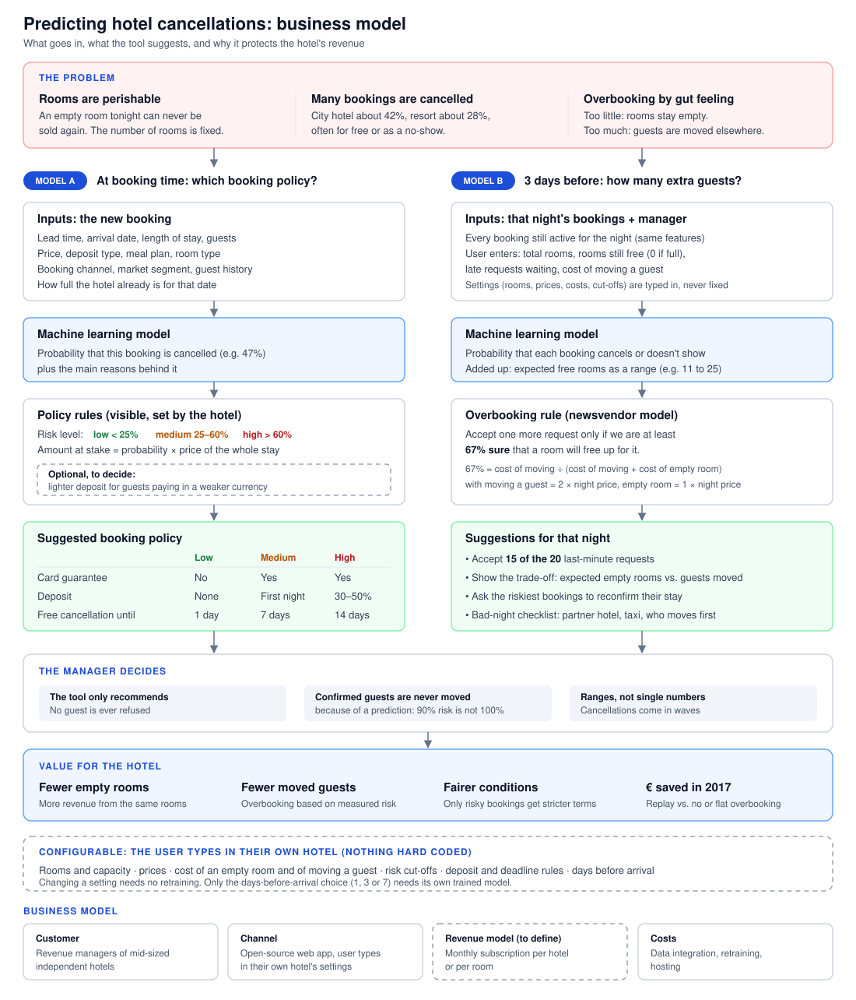

# Business Model (preliminary)

**Status:** third draft. Anything marked *(to define)* is still open. The open items are collected at the end.



## 1. The idea in one sentence

A decision-support tool that predicts which hotel bookings will be cancelled, so the manager can protect revenue in two ways: by setting the right booking policy (deposit, card guarantee, cancellation deadline) when a booking comes in, and by deciding how many last-minute bookings to accept 3 days before arrival even when the hotel looks full. The tool is **open and configurable**: any hotel types in its own capacity, prices and costs, and gets recommendations for its own situation.

## 2. The problem

### Why cancellations hurt a hotel

- **A hotel room is perishable.** A room that stays empty tonight can never be sold again. Its value is lost forever, like an airline seat after take-off.
- **The number of rooms is fixed.** A hotel can't add rooms on a busy night.
- **Guests can cancel or simply not show up,** often for free. In our data, about **42% of city hotel bookings** and **28% of resort hotel bookings** are cancelled.
- So a hotel that is "fully booked" on paper often ends up with empty rooms on the night itself, while it turned away other guests who wanted those rooms.

### The usual answer: overbooking

To make up for this, hotels (like airlines) **sell more rooms than they have**. If 100 rooms usually lose about 10 to cancellations, the hotel accepts around 110 bookings.

### The problem with overbooking

Overbooking is a bet, and it can go wrong in two directions:

| What goes wrong | What happens | Cost |
|---|---|---|
| **Too little overbooking** | More guests cancel than the hotel planned for. Rooms stay empty. | The price of each empty night |
| **Too much overbooking** | Fewer guests cancel than expected. More guests arrive than there are rooms. | Moving guests to another hotel (the "bad night" below) |

**The typical bad night:** it's a busy Saturday, the hotel is full, and at 10 pm a family arrives with a confirmed booking, but there is no room left. The front desk has to **"walk" the guest**: find a room at another hotel (often more expensive, because the whole city is busy that night), pay for it, pay for the taxi, and usually offer compensation. The guest is tired and angry, may write a bad review and may never come back.

Most hotels today choose the number of extra rooms **by gut feeling or a flat percentage** ("always overbook by 5%"). A flat percentage ignores that:
- a Saturday in August with many group bookings behaves differently from a Tuesday in February
- some bookings are much more likely to cancel than others
- cancellations come in waves (a cancelled group, a strike, a storm, a currency drop), so some nights are much worse than average

Booking conditions (deposit, deadline, refundable or not) are also usually the same for everyone, whatever the risk of that particular booking.

## 3. The customer

| | |
|---|---|
| **Who uses it** | The hotel's revenue manager or front-office manager |
| **Who pays** | The hotel, or the hotel group for several properties *(to define)* |
| **Where we start** | Mid-sized independent hotels, like the two in our data (one city hotel in Lisbon, one resort in the Algarve). Big chains often already have expensive revenue-management systems. |

## 4. How the product works (overview)

```
                    MODEL A (at booking time)                       MODEL B (3 days before arrival)
New booking ──► cancellation probability ──► policy rules ──► deposit, card guarantee,
                                                               cancellation deadline
                                                                        │
                                                                        ▼
Bookings still active 3 days before ──► probability each one cancels ──► expected free rooms (range)
Manager enters: rooms, last-minute requests, costs ──────────────────────► how many requests to accept,
                                                                            who to ask for reconfirmation
```

The machine learning part only produces **probabilities**. The suggestions (deposit, deadline, number of extra rooms) come from **simple, visible rules** on top of those probabilities. This keeps the tool explainable: the manager can see why it suggests something and change the rules.

## 5. Model A: booking policy at booking time

### What goes in

- Hotel type (city or resort). We use **one model for both hotels**, with the hotel type as an input, so the model can still learn that the city hotel cancels more often.
- Lead time: days between booking and arrival
- Arrival date: season, weekday, whether the stay includes a weekend, nearby holidays
- Length of stay, number of adults, children and babies
- Price (ADR), price per person, and price compared with the normal price for that month and room type
- Deposit type, meal plan, room type booked
- Booking channel (travel agent, online, direct, corporate) and market segment
- Guest history: repeat guest, earlier cancellations, earlier completed stays
- Special requests, parking request
- How full the hotel already is for that arrival date

Columns that are only filled in after the outcome is known are left out.

### What the model gives

One number: **the probability that this booking will be cancelled**, for example 47%. Plus the main reasons (for example "booked 200 days ahead", "no special requests", "booked through a travel agent").

### From probability to booking policy

The tool turns the probability into a concrete policy. Three things are set:

| Policy | Low risk (below 25%) | Medium risk (25% to 60%) | High risk (above 60%) |
|---|---|---|---|
| **Card guarantee** (card details kept, charged only on no-show) | No | Yes | Yes |
| **Deposit** | None | First night | 30% to 50% of the stay, or a non-refundable rate with a discount |
| **Free cancellation until** | 1 day before arrival | 7 days before arrival | 14 days before arrival |
| **Extra** | Nothing | Reconfirmation email 7 days before | Reconfirmation email 14 and 7 days before |

The cut-offs (25% and 60%) are starting values. How we set the final ones is explained further down.

**Why the deadlines are 7 and 14 days:** a cancellation that comes 7 or more days before arrival is known long before Model B's decision (section 6, 3 days before arrival), so the room can still be sold to someone else. Cancellations in the last 3 days are exactly what Model B has to estimate. All deadlines are settings the hotel can change (section 5b).

### The deposit is adjusted to the amount at stake

The deposit isn't only based on the probability. The tool also looks at **how much money is at risk**:

> Expected loss = probability of cancellation × total price of the stay

A 10-night stay at €200 with 50% risk puts €1,000 at risk. A 1-night stay at €80 with the same risk puts €40 at risk. Asking both guests for the same deposit makes no sense. So:
- the deposit is set to roughly cover the expected loss, rounded to simple steps (none, first night, 30%, 50%)
- it never goes above 50% of the stay, so guests aren't scared away
- in high-demand periods (for example summer weekends, big events) the deadline can be earlier, because a free room on those nights is worth more but is also easier to resell if we know early

### Adjusting for the guest's currency *(team idea, to decide)*

**The idea:** guests who pay in a weaker foreign currency (for example British guests after the pound fell in 2016) pay relatively more for the same stay. A big deposit hurts them more and may push them to book elsewhere. So the tool would ask for a **lighter deposit** from guests whose currency has lost value against the euro.

**What we need to be careful about:**
- This uses the guest's country (or currency) to treat guests differently. In the EU, treating customers differently because of their nationality or place of residence is legally sensitive, even when the difference is in the guest's favour.
- It also conflicts with our earlier choice to keep the model blind to nationality.

**A safer version we propose:**
- The **model** doesn't use country. It only predicts the probability.
- The **policy rules** use the *currency the guest pays in*, not the nationality, and the adjustment only ever **lowers** the deposit, never raises it.
- Or, simpler: offer every guest who pays in a foreign currency the option to **pay the deposit in instalments or in their own currency**. Same goal, but no guest gets worse conditions because of where they come from.

The team needs to choose one of these (see open questions).

### How we set the final cut-offs

1. **The model must be calibrated first.** A "60%" from the model must really mean that about 60 out of 100 of those bookings cancel. Otherwise the levels mean nothing.
2. **Set the cut-offs on 2016 data, never on 2017.** 2017 is our test year. If we tune on it, our results look better than they are. We use the last months of 2016 as a validation set.
3. **Check the size of each group.** The "high" group must not be too big (around 15% to 25% of bookings, *to define*). Otherwise we put stricter conditions on too many guests.
4. **Check the cost logic.** A non-refundable offer with a 10% discount pays off when the risk is well above 10%. We set the cut-off much higher (60%) on purpose, so we don't give away discounts or annoy guests who would have come anyway.

### Something to check in the data

In this dataset, bookings that were already non-refundable are said to cancel very often, which seems strange. We need to look at this in step 1. If it's true, "offer a non-refundable rate" may not work as an action, and a deposit or card guarantee may be better.

### A limit to mention

The model learns from the past, when these hotels had their old policies. If the hotel starts asking for deposits, guests will behave differently, and the model will need retraining on the new data after some months.

## 5b. Configurable settings (nothing hard coded)

The tool is meant to be **open and reusable**. The team's two hotels are only the example. Any hotel types in its own numbers, presses a button and waits for the answer. Everything below is a setting with a default, and the defaults are what we use in our own evaluation.

| Group | Setting | Default | Used by |
|---|---|---|---|
| **Hotel** | Total number of rooms (per room type, optional) | estimated from the data *(to define)* | Model B |
| | Rooms still free on paper for the night | 0 | Model B |
| | Last-minute requests waiting, and their price | entered per night | Model B |
| **Prices and costs** | Price per night (average, or per room type) | taken from each booking | Both |
| | Cost of an empty room | 1 × price of the night | Model B |
| | Cost of moving a guest | 2 × price of the night | Model B |
| | Currency | euro | Both |
| **Horizon** | Days before arrival for Model B | 3 | Model B |
| **Risk levels** | Cut-offs between low, medium and high | 25% and 60% | Model A |
| | Accepted share of "high" bookings (optional) | none | Model A |
| **Policy** | Deposit per level, card guarantee yes/no, free cancellation deadline, reconfirmation days | table in section 5 | Model A |
| | Maximum deposit | 50% of the stay | Model A |
| **Safety** | Overbooking confidence (the 67% in section 6) | calculated from the two costs, can be overridden | Model B |

**How the user works with it:**
1. Type in or upload the settings (a form in the app, or a small config file).
2. Optionally upload the hotel's own booking history, so the model can be retrained for that hotel. Without it, the tool uses the model trained on our dataset.
3. Enter a booking (Model A) or a night (Model B), and wait for the answer.
4. Change a setting and see how the answer changes (for example a different cost of moving a guest).

**What this means for the project:**
- Settings live in **one config file** (for example `config.yaml`) and in the app's side bar. The model code reads from there and never contains a fixed number.
- The probabilities come from the trained model. The recommendations (policy, number of extra guests) are calculated from the settings, so changing a setting needs **no retraining**.
- Only the horizon (3 days) changes what the model has to learn. Changing it means retraining Model B, so the app offers a few fixed choices (for example 1, 3, 7 days) trained in advance.
- The code is published open source on GitHub, with a short guide on how to add your own hotel *(to define: licence)*.

**A limit to state clearly:** the model learned from two Portuguese hotels from 2015 to 2017. For another hotel, the probabilities are only trustworthy after retraining on that hotel's own bookings. The app says so.

## 6. Model B: managing the rooms 3 days before arrival

### The situation

It's Wednesday the 7th. The manager looks at **Saturday the 10th**. On paper the hotel is full: all 200 rooms are booked. But the phone keeps ringing and the website keeps getting requests: 20 people want a room for that night at the last minute.

The question: **how many of these 20 should we accept?** Accept none, and we probably end up with empty rooms. Accept all 20, and we may have to send guests away on the night.

### What goes in

From the booking system (in our project: from the dataset):
- every booking still active for that night, with the same features as Model A
- the number of days left (a setting, default 3)

Entered by the manager:
- **total number of rooms** in the hotel
- **rooms still free on paper** (0 if the hotel is fully booked)
- **number of last-minute requests** waiting for that night, and their average price
- **cost of moving a guest** (slider, default 2 × the price of the night)

### What the model gives

For **each** booking still active: the probability that it is cancelled in the last 3 days or turns into a no-show.

Adding these up gives the **expected number of rooms that will free up**, for example 18. But the tool shows a **range** (for example 11 to 25), because cancellations come in waves. The range comes from how much our predictions were off on real days in the past.

### What the tool suggests

**1. How many last-minute requests to accept**

The rule, using the two costs:

> Accept one more request only if we are at least **X% sure** that a room will free up for it.
>
> X = cost of moving a guest ÷ (cost of moving a guest + cost of an empty room)

With our assumption (moving = 2 × price, empty = 1 × price): X = 2 ÷ 3 = **67%**.

In the example: we are 90% sure at least 11 rooms free up, 70% sure at least 15 free up, and 50% sure at least 18 free up. The tool recommends **accepting 15 of the 20 requests**. It shows what this means: "on about 1 in 3 nights like this, you'll have to move 1 to 3 guests; without overbooking, you'd have about 18 empty rooms".

Because moving a guest costs more than an empty room, the tool is careful: it accepts fewer requests than the average number of cancellations.

This technique is the standard one in revenue management (in textbooks it's called the **newsvendor model** or the **critical ratio**). What's new in our tool is that the probabilities come from each individual booking, not from a flat average.

**2. Who to ask for reconfirmation**

The bookings with the highest probability of not coming get a friendly message: "Please confirm your stay on the 10th." Guests who were going to cancel anyway often do it now instead of on the day, and the room becomes free officially and can be sold without any risk.

**3. A plan for the bad night**

If more guests arrive than there are rooms, the manager needs to be ready. The tool doesn't decide this, but the app shows a short checklist: a partner hotel nearby with an agreed price, a taxi budget, and which guest to move first (usually a one-night stay, not a repeat guest, not a family with children).

### What we do NOT do

**We never cancel or move a confirmed guest because the model says they probably won't come.** A 90% risk still means 1 in 10 of those guests arrives, and that guest has a confirmed booking. The model's probabilities are used only to decide how many *extra* bookings to accept and who to remind, never to take a room away from someone.

### How we test this with our data

The dataset has no "requests waiting" column, but it does contain bookings made less than 3 days before arrival (about 10% of all bookings, of which only about 8% are cancelled). We treat those as the **last-minute demand** for each night in 2017, and replay the year (section 8).

## 7. Costs

### Cost of an empty room

The money lost when a room stays empty: **the price of that night (ADR)**. We look at one night at a time, because overbooking is decided night by night.

Simplifications we accept and mention in the limits:
- An empty room also saves a little money (no cleaning, no breakfast), so the true loss is slightly lower than the price.
- If the guest paid a deposit that the hotel keeps, the loss is lower too.

### Cost of moving a guest to another hotel

The hotel pays:
- the room at the other hotel, which is often more expensive because it's a busy night
- transport to the other hotel (a taxi)
- often a small compensation (a voucher, a free night later)
- the risk that this guest never comes back and writes a bad review

**Our assumption:** moving a guest costs **2 times the price of the night**. The dataset doesn't contain this number, so it's an assumption. In the app it is a slider (from 1× to 4×), and in the evaluation we show how the recommendation changes with it. *(We'd like a source for the 2×. A revenue-management textbook or a hotel's walking policy would do.)*

## 8. How we show the value in euros

A hotel manager doesn't care about "precision" or "recall". They want to know how much money the tool saves. So we replay the year 2017, which the model has never seen, night by night, three times:

| Scenario | What the hotel does |
|---|---|
| **No overbooking** | Turns away all last-minute requests once it's full on paper |
| **Simple rule** | Always overbooks by the same percentage (for example 10%) |
| **Our tool** | Accepts the number of last-minute requests Model B recommends |

For each scenario we add up:
- **lost money from empty rooms** = number of empty rooms × price of the night
- **cost of moved guests** = number of moved guests × 2 × price of the night

The difference between the scenarios is the headline of the presentation, for example: *"In 2017, our tool would have saved the city hotel about € X compared with no overbooking."*

**Things we must assume for this simulation:**
- The dataset doesn't say how many rooms each hotel has. We can estimate it from the busiest night in the data *(to define)*.
- We use the bookings made less than 3 days before arrival as the last-minute demand.

Model A is harder to put in euros, because we don't know how guests would react to a deposit. For Model A we show what share of all 2017 cancellations falls into the "high" group, and how much money those bookings represented.

## 9. Value proposition

- **More revenue from the same rooms:** fewer rooms stay empty because of cancellations.
- **Fewer moved guests:** overbooking is based on measured risk instead of guesswork.
- **Fairer conditions:** low-risk guests keep flexible terms, and only higher-risk bookings get stricter ones.
- **Explainable:** every risk score comes with its reasons, and every suggestion comes from a visible rule.
- **Honest about uncertainty:** ranges instead of single numbers, because cancellations happen together (groups, strikes, weather, currency shocks).

## 10. How we measure success

| Metric | What it shows |
|---|---|
| Precision and recall against the baseline ("booked far in advance = high risk") | The model is better than a simple rule of thumb |
| Calibration | A predicted 30% risk really means about 30% cancel |
| Money saved in 2017 (section 8) | The business value, in the manager's own terms |
| Number of guests who would have been moved in 2017 | The cost side of overbooking |

## 11. How it is delivered

- A Streamlit web app with two screens: **"New booking"** (Model A, booking policy) and **"Last minute"** (Model B, last-minute requests)
- Models trained on 2015 and 2016 and tested on 2017, saved and loaded by the app
- In a real product: a connection to the hotel's booking system (PMS) and regular retraining *(out of scope for the course, but worth mentioning)*

## 12. Business model canvas (summary for the visual)

| Block | Content |
|---|---|
| **Customer segment** | Revenue managers of independent mid-sized hotels |
| **Problem** | Rooms are perishable and many bookings cancel; overbooking is done by gut feeling, causing empty rooms or moved guests |
| **Value proposition** | Predict cancellations, set fair booking policies, overbook safely |
| **Inputs** | Booking details, hotel occupancy, calendar data; manager enters rooms, last-minute requests and costs |
| **Solution / outputs** | Model A: cancellation probability → deposit, card guarantee, cancellation deadline. Model B: expected free rooms (range) → how many last-minute requests to accept, who to remind |
| **Channel** | Web app; later, integration with the booking system |
| **Revenue model** | Monthly subscription per hotel or per room *(to define, assumption only)* |
| **Key metrics** | Money saved, rooms left empty, guests moved, model calibration |
| **Costs** | Data integration, model maintenance and retraining, hosting |
| **Limits and ethics** | No guest is refused or moved because of a prediction; the manager decides; ranges instead of single numbers; nationality use still to decide |

## 13. Decisions and open questions

### Decided

| Decision | Reason |
|---|---|
| Cost of an empty room = price of the night | It's the money lost, and it's in the data |
| Cost of moving a guest = 2 × price of the night (assumption, adjustable) | Covers the other hotel, transport and compensation |
| Model B predicts 3 days before arrival (changed from 7) | Late bookings are the real overbooking window. The horizon is a setting. |
| The tool is configurable: the hotel enters its own capacity, prices and costs | Works for any hotel, nothing hard coded (section 5b) |
| One model for both hotels, with hotel type as an input | More data for training; the input lets the model treat the hotels differently |
| Three risk levels: below 25%, 25% to 60%, above 60% (starting values) | Tuned later on 2016 data |
| Model A sets deposit, card guarantee and cancellation deadline through visible rules | The model predicts, the rules decide, the manager can see and change both |
| Model B decides how many last-minute requests to accept | The standard overbooking rule, fed with per-booking probabilities |
| Confirmed guests are never cancelled or moved because of a prediction | A high risk is still not a certainty |

### Still open

1. **Do we adjust the deposit by the guest's currency or country?** Options: by nationality (legally risky), by payment currency and only downward, instalments for everyone paying in a foreign currency, or not at all.
2. **A source for the "2 × price" cost of moving a guest**, or we keep it as a stated assumption.
3. **The number of rooms per hotel**, needed for the 2017 simulation.
4. **Do non-refundable bookings really cancel so often in the data?** This decides whether "non-refundable rate" is a good action.
5. **How big the "high" group may be** (15% to 25% of bookings?).
6. **Which extra data we add:** holidays, events, exchange rates, or none.
7. **Revenue model**, if the presentation needs one.
8. **Who the main user is:** the revenue manager, the front desk, or both.
9. **Open-source details:** which licence, and a config file, a form, or both?
