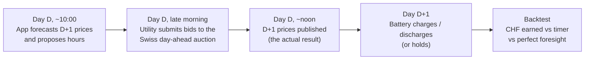
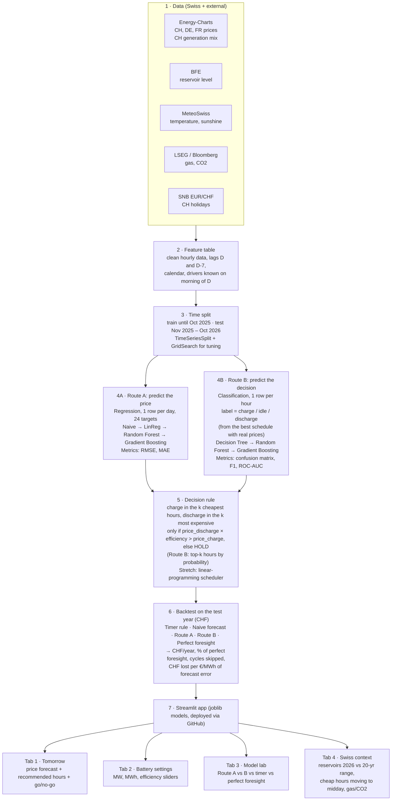

# Turbine or Hold? – A day-ahead battery planner for a Swiss utility

*Business Analytics & Data Science Applications (HSG, HS 2026) · Group project one-pager · v3 (base for team discussion)*

## 1. The user and the decision

**User:** a small or municipal Swiss utility that owns a **grid battery** (default **10 MW / 20 MWh**, i.e. 2 hours at full power). It has no trading desk, so today the battery runs on a **fixed timer** (charge at night, discharge in the evening).

**How it earns money:** it buys electricity on the Swiss day-ahead market to charge, and sells it back to discharge. A pumped-storage dam works the same way, only with water. About 10–15% of the energy is lost on each charge-and-discharge round trip.

**The problem:** tomorrow's hours must be committed **before tomorrow's prices are known**. Today's prices are known, tomorrow's are not.

**The daily decision (every morning, for tomorrow):**
1. **Go / no-go:** is tomorrow's price gap big enough to cover the losses? If not, **hold** (skip the cycle and save battery wear).
2. **Which hours:** when to charge (cheapest hours) and when to discharge (most expensive hours).

**Value to the utility:** extra CHF per year compared with the timer, and the **% of the perfect-foresight profit captured** (industry standard; realistic range 60–90%).

## 2. Data and parameters (Swiss focus, plus external drivers)

| Group | Variables (features) | Source | Why it matters | Known at decision time? |
|---|---|---|---|---|
| **Target** | Swiss day-ahead price, 24 hours of D+1 (€/MWh) | Energy-Charts API (`bzn=CH`) | What we predict | – |
| **Swiss price history** | Prices of D and D-7 (same hour), daily mean, daily max–min spread | Energy-Charts API | Prices repeat by day and week | Yes |
| **Calendar (CH)** | Hour, weekday, month, Swiss public holidays | `holidays` package | Demand pattern | Yes |
| **Swiss generation mix** | Hydro (run-of-river, storage, pumped), solar, nuclear output of D-1 | Energy-Charts API (`country=ch`) | Solar pushes midday prices down; hydro sets the evening price | Yes (D-1) |
| **Swiss water** | Reservoir fill level (%, last Sunday), deviation from the 20-year average | BFE weekly report | Low water (2026 drought) makes hydro hold back and raises prices | Yes |
| **Swiss weather** | Temperature and sunshine for D+1 (main stations) | MeteoSwiss open data | Demand (cold) and solar output (sun) | Forecast (we use observed values as a stand-in and say so) |
| **External: neighbours** | German (and possibly French) price of D | Energy-Charts API (`DE-LU`, `FR`) | Switzerland imports and exports heavily; prices are coupled | Yes |
| **External: fuels** | TTF gas price, EU CO₂ price (closing price of D-1) | HSG library: LSEG Workspace / Bloomberg | Gas and CO₂ set the price of the marginal power plant; they explain the 2022 spike | Yes (D-1) |
| **Conversion** | EUR/CHF | SNB data portal | Results in CHF | Yes |
| **Battery parameters (sliders)** | Power (MW), capacity (MWh), round-trip efficiency (~85–90%), max 1 cycle per day | User input | Scales the schedule and the profit | – |

**Period:** about 2019 → Oct 2026. **Train:** up to Oct 2025. **Test year:** Nov 2025 – Oct 2026 (includes the drought). No random splits: always train on the past and test on the future.

## 3. Workflow and model

**Research question:** is it better to predict the **price** (Route A) or the **decision** (Route B)? Both are judged in CHF, not only by forecast error.

## 4. Questions for the team to discuss

1. **Battery size:** is 10 MW / 20 MWh a realistic size for a Swiss municipal utility? Find one real example to quote.
2. **Timer rule:** what exact timer do we compare against (e.g. charge 02–04, discharge 18–20)? It has to look like what a utility would really do.
3. **Weather:** we use observed weather instead of a forecast, which flatters the model. Is that acceptable if we say so?
4. **2022:** train with the price spike (and rely on gas/CO₂ to explain it), or show results with and without it?
5. **Scope limits:** we ignore reserve markets (extra battery income), battery wear and the intraday market. Our profit is a lower bound. Agreed?
6. **15-minute prices:** if recent Swiss data is in 15-minute steps, we average to hourly. Fine?

## 5. Design decisions taken (and the alternatives)

An overview of what was chosen and what else was on the table, so everyone can challenge it.

| Decision | Chosen | Other options considered | Why we chose this |
|---|---|---|---|
| **End user** | Small or municipal Swiss utility with a grid battery (10 MW / 20 MWh), no trading desk | (a) Owner of a small dam without a pump (turbine now or hold water). (b) Utility with a share in a big pumped-storage plant (e.g. Nant de Drance). (c) Investor deciding whether to build or buy storage and what size. | Clear daily decision and a believable user: today it runs a fixed timer, so a forecast adds real value. (a) lacks inflow data per plant; (b) real owners already have professional software; (c) has no daily user. |
| **Core decision** | Every morning: go/no-go for tomorrow plus which hours to charge and discharge | (a) "Sell today at the known price or hold for tomorrow". (b) Both in the app. | Matches how the day-ahead market works (tomorrow's hours are committed the day before). The go/no-go covers the "hold" idea. |
| **Modelling approach** | Dual: Route A predicts the price (regression) vs Route B predicts the decision (classification), compared in CHF | (a) Price regression only. (b) Two horizons: tomorrow (hourly) plus weeks ahead (reservoir or price level). (c) ML vs the timer rule only. | Uses both main course modules and gives a real research question. (b) is more work with little data for the long model; (c) is a baseline we do anyway. |
| **Data and features** | Full set with a Swiss focus: Swiss prices, calendar, generation mix, reservoir level, weather, plus external drivers (German/French prices, gas, CO₂) | (a) Minimal: past Swiss prices and calendar only. (b) Swiss data plus neighbours, without gas and CO₂. | External drivers explain much of the Swiss price (imports, gas-fired marginal plants, the 2022 spike). Gas and CO₂ also make use of HSG's LSEG/Bloomberg access. |
| **Prediction target (Route A)** | All 24 hourly prices of tomorrow at once | (a) Only tomorrow's daily spread ("worth a cycle?"). (b) A ranking of the cheapest and most expensive hours. | Most flexible: works for any battery size and rule. (a) can't say which hours; (b) is harder to explain and evaluate. |
| **Forecast → schedule** | Simple rule now (k cheapest / k most expensive hours, only if the gap covers losses); linear-programming scheduler as a stretch goal | (a) Simple rule only. (b) Linear programming from the start. | The rule is easy to explain and enough for the course; the LP is more realistic but goes beyond the course and costs time. |
| **Evaluation** | Forecast error (RMSE/MAE) plus CHF backtest vs timer and perfect foresight, plus a "CHF lost per €/MWh of error" chart | (a) CHF backtest only. (b) Forecast error only. | The course expects standard metrics; the business case needs CHF. "% of perfect foresight" is the industry standard. |
| **App scope** | Tomorrow screen, battery size sliders, model lab, Swiss context | Annual value / investment tab (payback with cost inputs) | Keeps the app focused on the utility's daily use; the investment view would need cost data we don't have yet. |
| **Train / test split** | Train up to Oct 2025, test Nov 2025 – Oct 2026 (includes the 2026 drought) | Random split; shorter test period | Random splits leak future information in time series; a full test year covers all seasons. |
