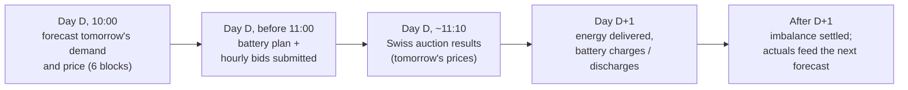
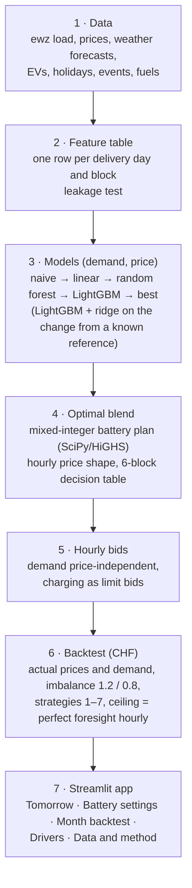

# Day Ahead – Demand and price forecasting for a Zurich DSO

*Business Analytics & Data Science Applications (HSG, HS 2026) · Group project one-pager · **v6 (final design and results)***

## 1. The user and the decision

**User:** **Limmat Energie AG**, a *fictional* **DSO** (distribution system operator) that supplies the city of
**Zurich**. It sits between the national grid operator (TSO, Swissgrid) and the homes and businesses of Zurich. Its
demand is the **real ewz grid load of the city of Zurich**. It has to buy the energy its customers will use, and it
owns a fictional **grid battery of 20 MW / 40 MWh** (usable 10–90 %, 90 % round trip, at most one cycle per day).

**Why Switzerland and Zurich:** the day-ahead price is the same for the whole of Switzerland (one price zone), so the
price model is Swiss. Demand is local, so the demand model is for the city of Zurich, which publishes its grid load
every 15 minutes as open data.

**The problem:** the DSO buys its energy on the Swiss **day-ahead auction**. The auction **closes once a day at
11:00** (checked in EPEX SPOT documents), and that is when every hour of tomorrow is bought. At that moment the DSO
knows neither tomorrow's demand nor tomorrow's price. If it buys too much or too little, the difference is an
**imbalance** that is settled at a worse price.

**The decision (once a day, at 10:00, for tomorrow):** for each **4-hour block of tomorrow** (00–04, 04–08, 08–12,
12–16, 16–20, 20–24):
1. **How much** energy to buy.
2. **How much to store** in the battery and when to use it (options: buy · buy and store · use storage and buy · use
   storage).
3. **At what price** to bid for the energy to store.

## 2. What we predict

| Target | Definition | Source |
|---|---|---|
| **Demand** | Mean load of the city of Zurich in each block (MW; × hours = MWh) | ewz "Bruttolastgang Stadt Zürich", 15 min, 2019 → Oct 2026 |
| **Price** | Mean Swiss day-ahead price of the block (EUR/MWh) | Energy-Charts API (`bzn=CH`), hourly |

The plan and the bids are **hourly**: inside each block we use a typical hourly price shape of the last 7 days of the
same day type, because a 2-hour battery fits inside one 4-hour block.

## 3. Drivers (features)

Everything is **known on day D at 10:00** (checked by an automated leakage test).

| Group | Examples | What we found |
|---|---|---|
| **Recent demand** | Same block on D−1 and one/four weeks back | By far the strongest demand driver |
| **Recent prices** | All prices of day D, 7-day block shape | Strongest price driver |
| **Weather** | Real ICON forecast for tomorrow (temperature, radiation) | Second-strongest group; radiation matters most |
| **Rooftop solar** | Radiation forecast, lagged Swiss solar | Enters through the radiation forecast; lagged solar adds almost nothing |
| **EVs** | Electric cars in Zurich, charging power in canton Zurich | No measurable effect on 4-hour load yet |
| **Calendar** | Block, weekday, holidays, school holidays, half-holidays | Essential (holidays: 4.49 vs 52.54 MW error for the naive rule) |
| **Events** | Street Parade, Züri Fäscht, Sechseläuten, home games | No measurable effect on city load |
| **Price drivers** | DE/FR/AT/IT prices of day D, gas, CO₂, EUR/CHF, reservoirs, German wind/solar forecasts | Neighbours, gas and German wind help a little; reservoirs add nothing |
| **Battery** | Power, capacity, efficiency, wear cost | Storage constraints only – **not** a demand input |

## 4. Time setup

- **Data:** 2019 → October 2026, 2,848 delivery days × 6 blocks.
- **Train** up to the end of August 2026 · **choose** models and decision rules on September 2026 (and on the rolling
  period for the decision rules) · **test once** on **October 2026** (31 days × 6 blocks = 186 forecasts per target).
- **Robustness:** a rolling backtest with monthly refits, October 2025 → August 2026.

## 5. Workflow and model

## 6. Key results (October 2026 test month)

| | Result |
|---|---|
| Demand forecast error | **3.34 MW** MAE (1.11 %); naive 9.58 MW |
| Price forecast error | **10.99 EUR/MWh** MAE; naive 23.47 EUR/MWh |
| Saving vs "naive demand, no battery" | **CHF 226,499** (0.50 % of the purchase cost) |
| … from the better demand forecast | CHF 181,033 |
| … from the battery | CHF 45,466 (76 % of the best possible battery value) |
| Share of the perfect-foresight ceiling | 60 % |
| Cost of the 4-hour block simplification (perfect foresight) | CHF 31,670 of battery value |
| Battery value vs size | almost linear, ~CHF 1,137 per MWh of capacity per month |
| Price error | CHF 475 of battery saving lost per 1 EUR/MWh of MAE per month |
| Year Oct 2025 – Sep 2026 (backtest) | CHF 2,382,678, of which CHF 693,805 battery |

**Main insight:** a good demand forecast is worth about four times the battery. Details: `reports/report.md`.

## 7. Decided questions (were open in v5)

| v5 question | Decision and how it was made |
|---|---|
| Block size: 4-hour blocks or 24 hours? | **Forecast 4-hour blocks, plan and bid hourly.** The backtest showed that block-only planning loses battery value; an hourly price shape inside the blocks won the tuning on pre-October data. |
| One test month or two? | **One clean test month (October 2026)** plus an 11-month rolling backtest for robustness. January 2026 is prepared as an optional second test month. |
| Observed weather instead of a forecast? | **Real forecasts** (Open-Meteo ICON, issued before 10:00) wherever they exist, always in validation and test. Observed weather only for training rows before 21 Jan 2024 (no forecast archive); documented limitation. |
| Who builds the event list? | Built by hand with a source URL for every row; unconfirmed events are listed in `docs/events_unverified.md`. Result: events have no measurable effect. |
| Keep the battery in the decision? | **Yes**, as a fictional 20 MW / 40 MWh battery with sliders in the app. It adds CHF 45,466 in October, but the demand forecast adds four times more. |

## 8. What changed

| | v3 | v4 | v5 | **v6 (now)** |
|---|---|---|---|---|
| User | Utility with a battery | DSO (plus a battery) | ewz, Zurich's DSO (plus a battery) | **Limmat Energie AG (fictional DSO), real ewz load of Zurich** |
| What we predict | Price only | Demand and price | Demand and price | **Demand and price per 4-hour block** |
| How often | Once a day | Every 4 hours, next 4 hours | Once a day at 11:00, for tomorrow | **Once a day at 10:00, for tomorrow** |
| Time step | 24 hourly prices | One 4-hour block | 6 blocks of 4 hours | **6 blocks forecast, hourly plan and bids** |
| Market | Day-ahead | Intraday | Day-ahead (auction closes 12:00) | **Swiss day-ahead, gate closure 11:00 (verified)** |
| Battery | yes | yes | 10 MW / 20 MWh | **20 MW / 40 MWh, mixed-integer plan** |
| Decision rule | – | – | charge cheapest, discharge dearest block | **optimiser + limit bids, tuned on pre-October data** |
| Test | One full year | One month | One month (~186 block forecasts) | **October 2026 (186 per target) + rolling Oct 2025 – Aug 2026** |
