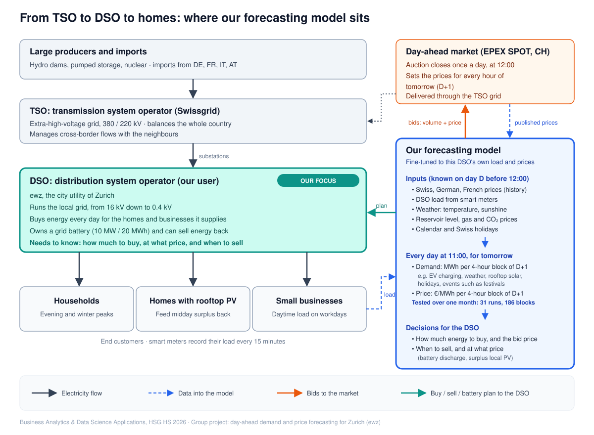
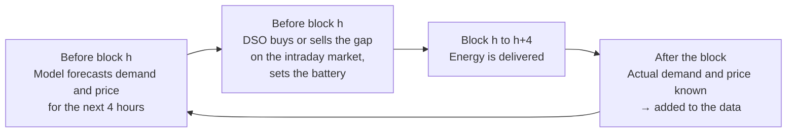
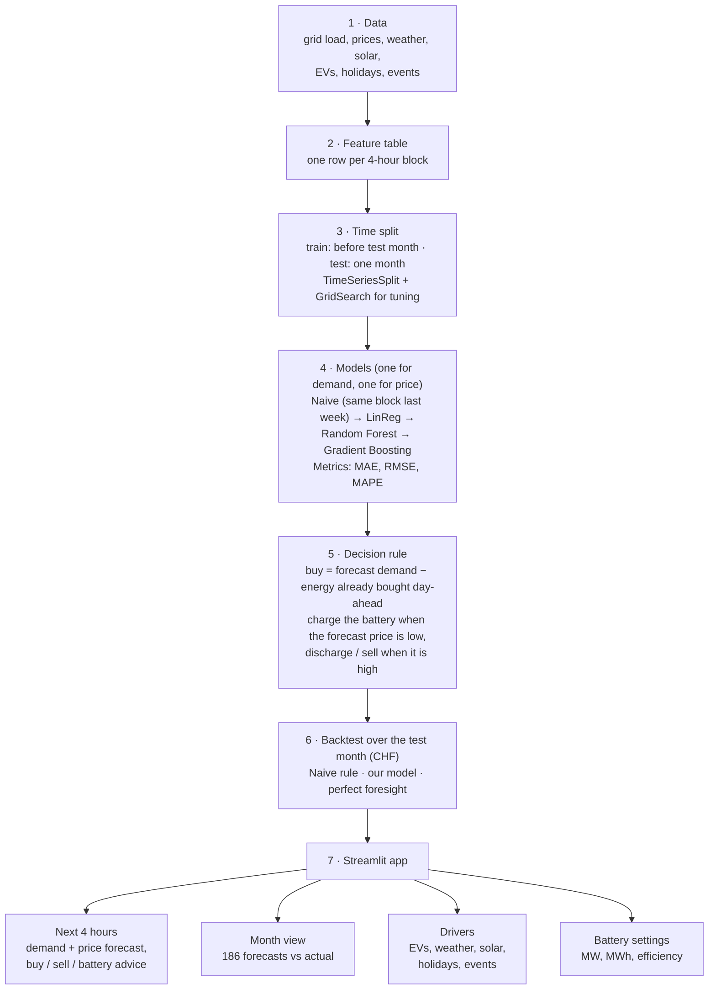

# Four Hours Ahead – Demand and price forecasting for a Swiss DSO

*Business Analytics & Data Science Applications (HSG, HS 2026) · Group project one-pager · v4 (base for team discussion)*

## 1. The user and the decision

**User:** a Swiss **DSO** (distribution system operator): a municipal or regional utility, such as a Stadtwerk. It sits between the national grid operator (TSO, Swissgrid) and the homes and businesses it supplies. It has to buy the energy its customers use. It also owns a **grid battery** (default **10 MW / 20 MWh**), so it can store energy and sell it back.

**The problem:** the DSO buys most of its energy the day before, on the day-ahead market. But demand and prices move during the day:
- **EVs** charging in the evening
- **Weather**: cold days mean more heating
- **Rooftop solar** lowering demand at midday
- **Holidays**
- **Events** such as festivals or big football matches

The gap between what was bought and what is needed has to be bought or sold at short notice on the **intraday market**. If the DSO gets it wrong, it pays an imbalance penalty.

**The decision (every 4 hours, 6 times a day: 00, 04, 08, 12, 16, 20):** for the **next 4-hour block**:
1. **How much** energy to buy, or to sell, to match forecast demand.
2. **At what price** to bid, and whether to charge or discharge the battery.

**Value to the DSO:** CHF saved compared with a simple rule (for example "same as this block last week"), fewer imbalance costs, and the **% of the perfect-foresight result captured**.

## 2. What we predict

Two targets, one value each for every 4-hour block:

| Target | Definition | Candidate source (to check) |
|---|---|---|
| **Demand** | Total energy used in the DSO's area in the block (MWh) | Open grid-load data of a Swiss city, e.g. ewz Zurich on opendata.swiss (15-minute steps). Fallback: total Swiss consumption from Swissgrid |
| **Price** | Average price of the block (€/MWh) | Swiss intraday price (EPEX, possibly via LSEG/Bloomberg at HSG), or Swissgrid's imbalance/balancing energy price |

Note: the **day-ahead price** of the block is already known when we forecast, because it was published the day before. So it is an **input**, not a target.

## 3. Drivers (features)

Everything must be **known before the block starts**.

| Group | Examples | Source | Why it matters |
|---|---|---|---|
| **Recent demand** | Demand of the last block, same block yesterday, same block last week | Grid load / smart meters | Demand repeats by day and week |
| **Weather** | Temperature, sunshine, wind | MeteoSwiss open data | Heating in winter, cooling in summer |
| **Rooftop solar** | Sunshine or solar radiation, solar output in CH | MeteoSwiss, Energy-Charts | Solar on roofs lowers demand from the grid at midday |
| **EVs** | Number of EVs in the area, public charging-point usage | BFS / ASTRA vehicle data, BFE charging-station data | Evening charging creates new peaks |
| **Calendar** | 4-hour block of the day, weekday, month, Swiss and cantonal holidays, school holidays | `holidays` package, cantons | Demand pattern |
| **Events** | Festivals, big concerts, football matches (e.g. Street Parade, Züri Fäscht) | Our own event list (yes/no flag) | Unusual peaks and drops |
| **Price drivers** | Day-ahead price of the block, recent intraday prices, DE/FR prices, gas and CO₂ prices, reservoir level, EUR/CHF | Energy-Charts, LSEG/Bloomberg, BFE, SNB | Explain where the short-term price goes |
| **Battery (sliders)** | Power (MW), capacity (MWh), efficiency (~85–90%) | User input | Scales the plan and the CHF |

## 4. Time setup

- **Data:** about 2019 → October 2026, aggregated from 15 minutes or hourly to **4-hour blocks**.
- **Rolling forecast:** at the start of each block, the model only uses what is known at that moment and predicts the next 4 hours. Then the block's actual values are added and it moves on to the next one.
- **Test period:** **one month** (for example October 2026) = 6 blocks × ~31 days ≈ **186 forecasts** each for demand and price.
- **Training:** all data before the test month. No random splits.

## 5. Workflow and model

## 6. Questions for the team

1. **Price target:** intraday price or imbalance price? Which one can we actually download for Switzerland?
2. **Which DSO:** do we use one real city's open grid-load data (e.g. Zurich) or the Swiss total?
3. **Test month:** one month only, or one winter and one summer month to show the seasons?
4. **Weather:** we use observed weather instead of a forecast, which flatters the model. Is that fine if we say so?
5. **Events:** how do we build the event list, and for which city?
6. **Battery:** do we keep it in the decision, or focus only on buying and selling?

## 7. What changed from v3

| | v3 | v4 (now) |
|---|---|---|
| User | Utility with a battery, no trading desk | DSO supplying homes and businesses (plus a battery) |
| What we predict | Price only | **Demand and price** |
| Time step | 24 hourly prices for tomorrow | **Next 4-hour block, every 4 hours** |
| Market | Day-ahead auction | Intraday market (day-ahead is the base) |
| Test | One full year | **One month (~186 forecasts)** |
