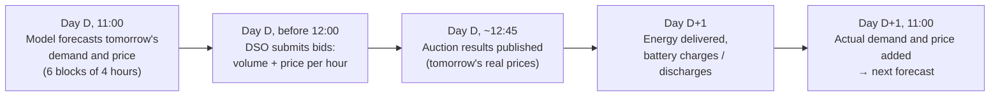
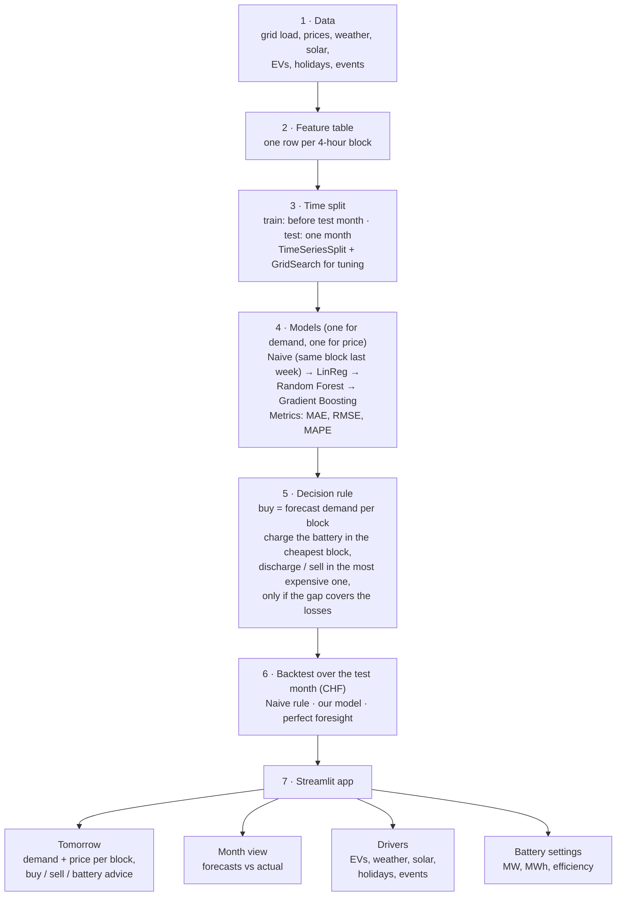

# Day Ahead – Demand and price forecasting for Zurich's DSO (ewz)

*Business Analytics & Data Science Applications (HSG, HS 2026) · Group project one-pager · v5 (base for team discussion)*

## 1. The user and the decision

**User:** **ewz**, the city utility of **Zurich** and its **DSO** (distribution system operator). It sits between the national grid operator (TSO, Swissgrid) and the homes and businesses of Zurich. It has to buy the energy its customers will use. It also owns a **grid battery** (default **10 MW / 20 MWh**), so it can store energy and sell it back.

**Why Switzerland and Zurich:** the day-ahead price is the same for the whole of Switzerland (one Swiss price zone), so the price model is Swiss. Demand is local, so the demand model is for the city of Zurich. Zurich also publishes open data for everything we need: grid load every 15 minutes, weather, EVs, school holidays and events.

**The problem:** the DSO buys its energy on the **day-ahead market**. The auction **closes once a day at 12:00**, and that is when every hour of tomorrow is bought. At that moment the DSO knows neither tomorrow's demand nor tomorrow's price. Demand depends on:
- **EVs** charging in the evening
- **Weather**: cold days mean more heating
- **Rooftop solar** lowering demand at midday
- **Holidays**
- **Events** such as festivals or big football matches

If the DSO buys too much or too little, it has to correct this later at a worse price or pay an imbalance penalty.

**The decision (once a day, at 11:00, for tomorrow):** for each **4-hour block of tomorrow** (00–04, 04–08, 08–12, 12–16, 16–20, 20–24):
1. **How much** energy to buy to match forecast demand.
2. **At what price** to bid, and when to charge or discharge the battery (buy when cheap, sell when expensive).

**Value to the DSO:** CHF saved compared with a simple rule (for example "same as the same day last week"), fewer imbalance costs, and the **% of the perfect-foresight result captured**.

## 2. What we predict

Two targets, one value each for every 4-hour block of tomorrow (6 per day):

| Target | Definition | Candidate source (to check) |
|---|---|---|
| **Demand** | Total energy used in the city of Zurich in the block (MWh) | ewz "Bruttolastgang Stadt Zürich" (data.stadt-zuerich.ch, 15-minute steps, 2019 → now). Fallback: total Swiss consumption from Swissgrid |
| **Price** | Average Swiss day-ahead price of the block (€/MWh) | Energy-Charts API (`bzn=CH`), free |

The auction prices hours (or 15 minutes), not 4-hour blocks. We average to 4-hour blocks to keep the model simple. Going to 24 hourly values later is a small change.

## 3. Drivers (features)

Everything must be **known on day D before 12:00**.

| Group | Examples | Source | Why it matters |
|---|---|---|---|
| **Recent demand** | Demand of today so far, same block yesterday, same block last week | Grid load / smart meters | Demand repeats by day and week |
| **Recent prices** | Today's day-ahead prices (known since yesterday), same block last week | Energy-Charts | Prices repeat by day and week |
| **Weather** | Temperature, sunshine, wind for tomorrow | MeteoSwiss, station Zürich-Fluntern | Heating in winter, cooling in summer |
| **Rooftop solar** | Sunshine or solar radiation, solar output in CH | MeteoSwiss, Energy-Charts | Solar on roofs lowers demand from the grid at midday |
| **EVs** | Electric cars in the city of Zurich, charging capacity in Kanton Zürich | Stadt Zürich open data, BFE charging-station data | Evening charging creates new peaks |
| **Calendar** | 4-hour block, weekday, month, Zurich public holidays, Zurich school holidays | `holidays` package (ZH), Stadt Zürich school holidays | Demand pattern |
| **Events** | Festivals, big concerts, football matches (e.g. Street Parade, Züri Fäscht) | Our own event list (yes/no flag) | Unusual peaks and drops |
| **Price drivers** | DE/FR prices, gas and CO₂ prices, reservoir level, EUR/CHF | Energy-Charts, LSEG/Bloomberg at HSG, BFE, SNB | Explain where the Swiss price goes |
| **Battery (sliders)** | Power (MW), capacity (MWh), efficiency (~85–90%) | User input | Scales the plan and the CHF |

## 4. Time setup

- **Data:** about 2019 → October 2026, aggregated from 15 minutes or hourly to **4-hour blocks**.
- **Daily forecast:** every day at 11:00 the model uses only what is known at that moment and forecasts the 6 blocks of tomorrow. The next day, the real values are added and it runs again.
- **Test period:** **one month** (for example October 2026) = ~31 daily runs × 6 blocks = **~186 block forecasts** each for demand and price.
- **Training:** all data before the test month. No random splits.

## 5. Workflow and model

## 6. Questions for the team

1. **Block size:** keep 4-hour blocks, or forecast all 24 hours of tomorrow?
2. **Test month:** one month only, or one winter and one summer month to show the seasons?
3. **Weather:** we use observed weather instead of a forecast, which flatters the model. Is that fine if we say so?
4. **Events:** who builds the Zurich event list (Street Parade, Sechseläuten, Züri Fäscht, football)?
5. **Battery:** do we keep it in the decision, or focus only on buying?

## 7. What changed

| | v3 | v4 | v5 (now) |
|---|---|---|---|
| User | Utility with a battery | DSO (plus a battery) | **ewz, Zurich's DSO** (plus a battery) |
| What we predict | Price only | Demand and price | **Demand and price** |
| How often | Once a day | Every 4 hours, next 4 hours | **Once a day at 11:00, for tomorrow** |
| Time step | 24 hourly prices | One 4-hour block | **6 blocks of 4 hours** |
| Market | Day-ahead | Intraday | **Day-ahead (auction closes 12:00)** |
| Test | One full year | One month | **One month (~186 block forecasts)** |
