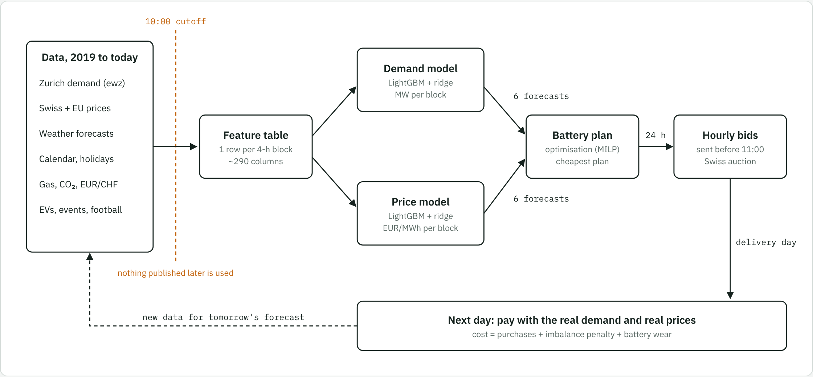
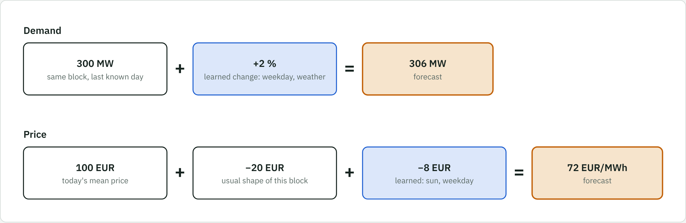
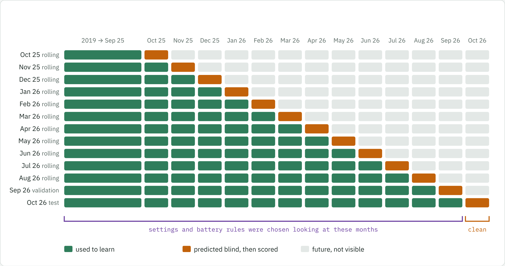
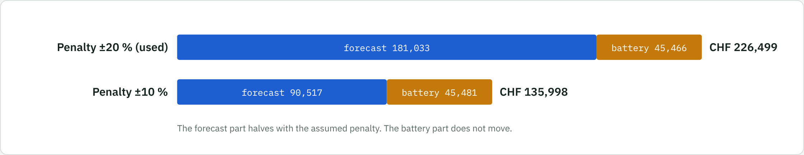

# Morandini review

Review of the day-ahead planning project (November 2026). All tests and notebooks pass; nothing in the project was changed.

| File | What it is |
|---|---|
| [`README.md`](README.md) | this page: the project at a glance, in four diagrams |
| [`checklist.md`](checklist.md) | sixteen review points, each marked **DO**, **DECLARE** or **FUTURE** |
| [`project_at_a_glance.pdf`](project_at_a_glance.pdf) | the diagrams as a single page |
| [`review_checklist.pdf`](review_checklist.pdf) | the checklist as a single page |

## Day-ahead planning, at a glance

A fictional Zurich utility with a 20 MW / 40 MWh battery has to buy tomorrow's electricity at the Swiss auction before 11:00. The four diagrams below show how the project decides what to buy and how we measured whether it works.

| | |
|---|---|
| **13 / 13** | months with a saving vs the naive rule |
| **1.5 %** | average demand forecast error |
| **8.6 %** | average price forecast error (up to 20 % in spring) |
| **CHF 2.61 M** | saved over 13 months, of which CHF 0.74 M from the battery |

### 1. Every day: from data to bids in one hour

At 10:00 the system only uses information that was already published (the orange line; an automated test checks this). Two models forecast the six 4-hour blocks of tomorrow, the optimiser plans the battery, and the plan becomes hourly bids. The next day the real demand and prices decide what it actually cost.

### 2. Inside a forecast: start from what is known, learn only the change

Example numbers. Grey boxes are known at 10:00; blue boxes are what the models learned from 16,716 past blocks. The models are a blend of LightGBM (many small if-then rules) and ridge regression (a simple weighted formula): 85 / 15 for demand, 65 / 35 for price.

### 3. How we tested it: predict each month blind, then score it

Each row is one test: the models learn from everything before the month (green), predict the month without seeing it (orange), and are scored against what really happened. The scoring is correct, but the settings were picked while looking at the first 12 months, so those scores are slightly optimistic (estimated 1–3 %). Only October 2026 was never used to choose anything.

### 4. Where the money comes from: October 2026, and how much rests on one assumption

Saving vs buying last week's demand with no battery. Most of it is avoided imbalance penalty, priced with our own assumption (shortage +20 %, surplus −20 %) because real Swissgrid prices were not available. Halving that assumption cuts the total by 40 %.

---

Sources: project result files (`reports/metrics_*.csv`, `reports/backtest.csv`, `reports/decision_tuning.csv`, `reports/backtest_decision_sensitivity.csv`, `reports/predictions_*.parquet`). Demand is the real ewz grid load of Zurich; the company and the battery are fictional.
