# Day-ahead planning for a Zurich DSO: demand and price forecasts, a grid battery and auction bids

*HSG · Business Analytics & Data Science Applications · HS 2026 · Group project report*

*All numbers in this report come from the result files in `reports/` and `data/processed/`. The tables are printed
by `reports/make_report_tables.py`; `python reports/make_report_tables.py --check reports/report.md` confirms that
every table below still matches the files. Money is in **CHF** (converted hour by hour with the ECB EUR/CHF rate of
the delivery day) unless a column says EUR. **October 2026 is the test month**; September 2026 is the validation
month; "rolling" means the robustness run from 1 Oct 2025 to 31 Aug 2026.*

---

## 1. Summary

**The user.** *Limmat Energie AG* is a fictional distribution system operator (DSO) that supplies the city of
Zurich. Its demand is the real ewz grid load of the city (290.8 MW on average in October 2026). Every morning it
must buy tomorrow's electricity on the Swiss day-ahead auction, which closes at 11:00. It also owns a fictional
20 MW / 40 MWh grid battery.

**What we built.** At 10:00 on day D the system forecasts Zurich demand and the Swiss price for the six 4-hour
blocks of day D+1, plans the battery with a small optimisation model, turns the plan into hourly auction bids and,
in the backtest, settles them with the real prices and the real demand.

**Key results (test month October 2026).** All model and decision choices were made before October. One weather
pre-processing choice (which method corrects the bias of the temperature forecast) also looked at October weather
data, but not at October demand or prices (§8).

> **Read the money with care.** The CHF numbers are a **simulation of one test month** with **assumed imbalance
> prices** (shortage at p + 0.2·|p|, surplus at p − 0.2·|p|) and a **fictional 20 MW / 40 MWh battery**. About 80 %
> of the October saving (CHF 181,033 of CHF 226,499) comes from avoiding the assumed imbalance penalty. With half the
> penalty (±10 %) the saving would be CHF 135,998 (CHF 90,517 demand forecast + CHF 45,481 battery). Swissgrid's real
> settlement is quarter-hourly with a single imbalance price since 2026, and there a deviation can even help the
> system. So our numbers do not prove that the demand forecast is worth more than the battery under real settlement.

| | Result |
|---|---|
| Demand forecast error (MAE) | **3.34 MW** (1.11 %), naive rule 9.58 MW |
| Price forecast error (MAE) | **10.99 EUR/MWh**, naive rule 23.47 EUR/MWh |
| Saving of the product vs the simple rule "buy last week's demand, no battery" (simulated, assumed imbalance prices) | **CHF 226,499** in the month; 95 % interval 158,868 to 306,077 if the days were independent, 129,685 to 354,460 when runs of 7 days are kept together; 0.50 % of the baseline's total cost including imbalance (CHF 45,685,820) |
| … of which from the better demand forecast (depends on the assumed penalty) | **CHF 181,033** |
| … of which from the battery | **CHF 45,466** |
| Same saving with half the assumed imbalance penalty (±10 %) | CHF 135,998 (demand 90,517, battery 45,481) |
| Share of the best possible saving (perfect foresight, hourly) | **60 %** (battery alone: 76 % of its best possible value) |
| Sum over the rolling period Oct 2025 – Aug 2026 (used for tuning the decision rules) plus September 2026 (validation), 365 days – **not an out-of-sample test** | **CHF 2,382,678** saved, of which CHF 693,805 from the battery |

**The main business insight.** Under the assumed imbalance prices, the better demand forecast is worth about four
times as much as the battery in the test month (CHF 181,033 vs CHF 45,466) and more than twice as much over the
rolling year. The demand forecast saves money by avoiding imbalance penalties; the battery earns money by shifting
energy from cheap to dear hours. How much the demand forecast is worth depends directly on the assumed penalty
(§6.6), so this ranking holds for our assumption, not necessarily for Swissgrid's real settlement. Battery value
grows nearly in proportion to its size in our simulation (CHF 1,134–1,138 per MWh of capacity), because we assume
the battery does not move prices. In a random-noise experiment with perfect demand, every 1 EUR/MWh of block-price
error cost about CHF 475 of battery saving per month; our real ML price forecast (error 10.99 EUR/MWh) lost only
CHF 610 under the same rules.

---

## 2. The business problem

### 2.1 Who is who

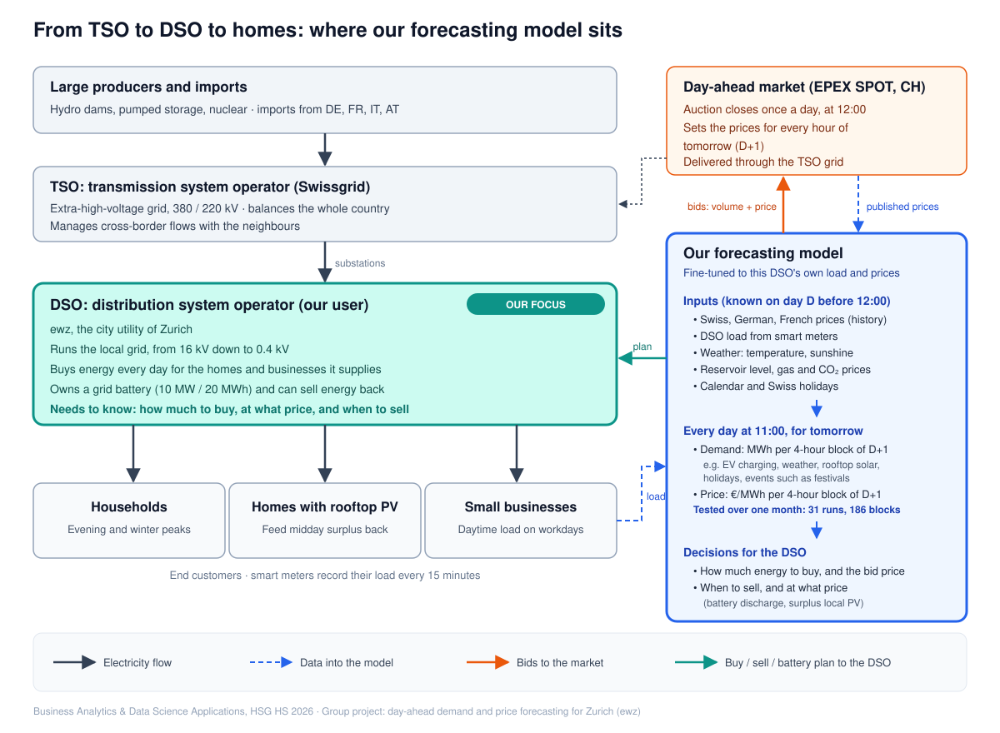

- The **TSO** (transmission system operator, in Switzerland *Swissgrid*) runs the national high-voltage grid and
  keeps supply and demand in balance every second.
- The **DSO** (distribution system operator) runs the local grid of a city and supplies its homes and businesses.
  Our DSO is the fictional *Limmat Energie AG* for the city of Zurich.
- The DSO must **buy** the energy its customers will use. Most of it is bought one day ahead on the **day-ahead
  auction**: an exchange (EPEX SPOT) collects all buy and sell bids for every hour of tomorrow and sets one price per
  hour for the whole of Switzerland.
- If the DSO later delivers more or less energy than it bought, the difference is an **imbalance**. The TSO settles it
  at an **imbalance price** that is normally worse than the auction price.

### 2.2 The daily decision

Every day, before the auction closes, the DSO decides for each of the six 4-hour blocks of tomorrow (00–04, 04–08,
08–12, 12–16, 16–20, 20–24, local time):

1. **How much to buy** at the auction.
2. **How much to store** in the battery, and when to use the stored energy.
3. **At what price to bid** for the extra energy it wants to store.

The battery state is described by its **state of charge**: the energy stored in it, in MWh (here between 10 % and
90 % of 40 MWh).

### 2.3 Timeline of one day

The Swiss day-ahead auction closes at **11:00** on the day before delivery, and results are published from about
11:10. We checked this in EPEX SPOT trading brochures from 2020 to 2024 (`docs/auction_timing.md`); the original
project brief assumed 12:00, which is the closing time of the coupled EU auction, not the Swiss one. So our forecast
time is **10:00 on day D** for delivery on day D+1. A side effect: the German and French prices for D+1 are set at
12:00 and published around 12:45, so they are **not** known when we forecast. Only their prices for day D are.

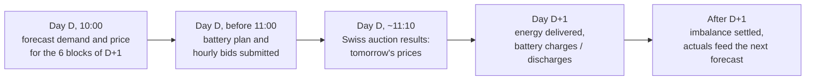

---

## 3. Architecture

The team's diagram has three inputs (demand model, price model, storage constraints), a choice between options
("buy and store / use storage?"), an optimal blend, a decision and the auction purchase. We kept this structure and
built every box in code.

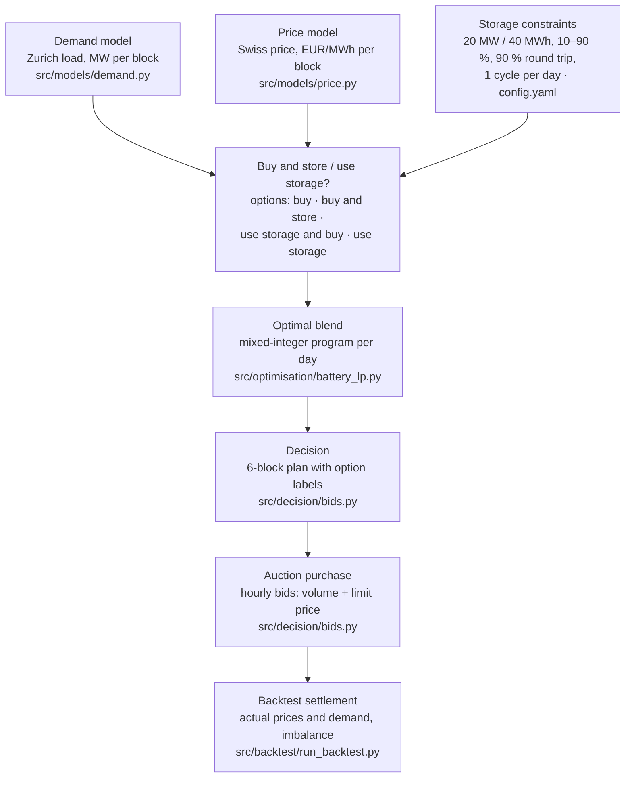

| Box in the team's diagram | What it became |
|---|---|
| Demand model ("usage", weather, EVs, holidays …) | LightGBM + ridge model of Zurich load per block. "Usage" means **past demand** (lags). |
| Storage capacity as a demand input | **Removed from the demand model.** The battery does not change how much Zurich consumes; it only appears in the storage constraints. |
| Price model | LightGBM + ridge model of the Swiss day-ahead price per block |
| Storage constraints | Battery parameters in `config.yaml`; sliders in the app |
| Buy and store / use storage? | Every block gets one of the team's labels: `buy`, `buy_and_store` (charging), `use_storage_and_buy` (discharging, still buying), `use_storage` (buying almost nothing). Plain "store" without buying cannot happen, because Zurich always needs energy. |
| Optimal blend | A small optimisation model that minimises tomorrow's expected cost |
| Decision → auction purchase | Hourly bids: a price-independent bid for the city's demand, a limit-price bid for extra energy to store |
| (new) Backtest | Settles every bid with the actual hourly prices and demand, adds imbalance and battery wear |

The web app (`web/`, built with Bun and TanStack) shows the same chain for any day of the test month.

---

## 4. Data

### 4.1 Sources

| Input | Source | Step | Used for |
|---|---|---|---|
| Zurich demand (target) | ewz "Bruttolastgang Stadt Zürich", Stadt Zürich open data; cross-check with ewz "Stromabgabe Netzebenen" | 15 min, local time | target, demand lags |
| Swiss day-ahead price (target) | Energy-Charts API (Fraunhofer ISE), `bzn=CH` | 1 h | target, price lags |
| Neighbour prices | Energy-Charts, DE-LU, FR, AT, IT-North | 1 h (15 min from Oct 2025, averaged) | price features (day D only) |
| Swiss load, solar, hydro, nuclear | Energy-Charts `public_power` | 1 h | price features (D−1) |
| Observed weather | MeteoSwiss station Zürich-Fluntern (SMA) | 1 h | past weather, training stand-in before 2024 |
| Weather forecasts, Zurich | Open-Meteo previous-runs API: ICON (from 2024-01-19), ECMWF, JMA (back to 2018) | 1 h | weather of D+1 |
| Weather forecasts, Europe | Open-Meteo previous-runs API, 9 points in DE/FR/IT/CH (ICON, JMA) | 1 h | German wind and solar, French temperature for the price |
| Reanalysis | Open-Meteo archive (ERA5) | 1 h | cross-check only, never an input |
| EVs | Stadt Zürich car stock by fuel (yearly), BFE charging stations canton Zurich (monthly) | daily | demand features |
| Calendar | `holidays` package (ZH) + Berchtoldstag, Stadt Zürich school holidays, OxCGRT COVID index | daily | demand and price features |
| Events and football | Hand-made table with a source URL per row; football-data.co.uk Super League results | daily | demand features |
| Gas, CO₂, FX, hydro | Yahoo `TTF=F` (unofficial), EEX EUA auction results, ECB EUR/CHF, BFE reservoir levels | daily / weekly | price features; ECB rate for CHF |

Raw data covers 2019-01-01 to 2026-10-31. The feature table has one row per delivery day and block: 2,848 delivery
days × 6 blocks = 17,088 rows (`reports/data_checks.md`). Full details are in `docs/data_sources.md`,
`docs/data_dictionary.md` and `docs/assumptions.md`.

### 4.2 Cleaning highlights

- **ewz time stamps mark the end of each 15-minute interval**, in local time. We proved this by comparing with the
  ewz Netzebenen file, which is in UTC and documented: the correlation is 0.999993 with no shift and 0.9966 with a
  15-minute shift.
- **Daylight-saving days.** On the autumn change the local labels 02:00–02:45 appear twice. The order of the two rows
  in the file is not consistent (it would be wrong in 27 of 32 pairs), so each pair was matched to the Netzebenen
  values instead. After conversion to UTC there are no duplicates, and every year has exactly one 23-hour and one
  25-hour day (figure below, `notebooks/01_eda.ipynb`).
- **Two missing days** in the 2021 ewz file (30 May and 7 Aug, 192 quarter-hours = 0.07 %) were filled from the
  Netzebenen file and flagged.
- **ewz status flags:** no value is final (status W). All values are "substitute" (E), except "not yet checked" (F) in
  June 2020 and November 2026. We keep them all; this is a limitation (§8).
- **Prices:** no missing hour from 2019 to October 2026. Negative prices are kept (they are real).
- **Swiss load** from Energy-Charts is broken after 16 Nov 2026 and on a few earlier days; those hours are flagged
  and treated as missing.
- **Blocks follow the local clock**, so on clock-change days block 00–04 has 3 or 5 hours. Targets are therefore
  **mean MW per block**; costs use MW × hours.

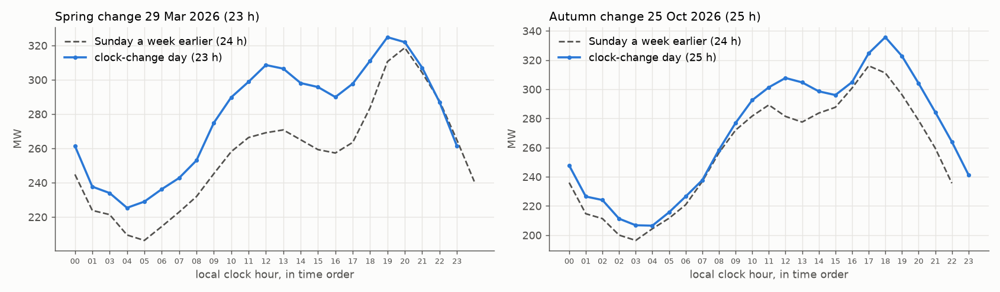

### 4.3 What the data shows

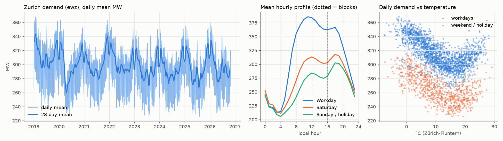

Demand has a strong daily and weekly rhythm and rises on cold days. Its level has hardly changed since 2020. The
Swiss price is a different story: it went through the 2021–2022 energy crisis, and negative-price hours (sunny
weekend middays) became common from 2024.

<!-- table:price_years -->
| year | mean CH price (EUR/MWh) | hours with negative price | mean Zurich demand (MW) |
|---|---|---|---|
| 2019 | 40.9 | 17 | 312.9 |
| 2020 | 34.0 | 75 | 299.4 |
| 2021 | 114.9 | 41 | 301.1 |
| 2022 | 281.7 | 1 | 302.2 |
| 2023 | 107.5 | 76 | 295.1 |
| 2024 | 76.0 | 292 | 295.3 |
| 2025 | 101.7 | 303 | 295.9 |
| 2026 (Jan–Oct) | 131.7 | 239 | 296.3 |
<!-- /table -->

*Calendar years by local delivery day, from `data/processed/hourly_actuals.parquet`; 2026 up to 31 October.*

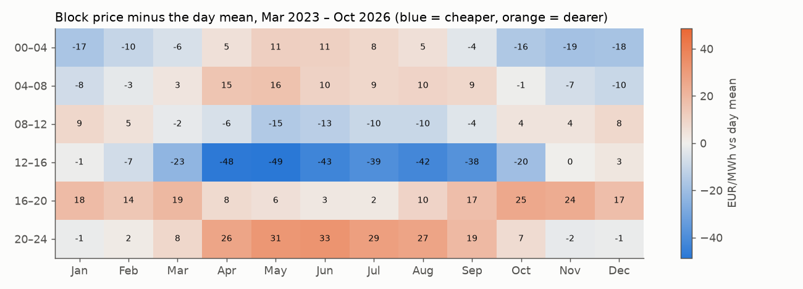

The battery lives on the gap between cheap and dear hours of the same day. From April to September the 12–16 block
is 38 to 49 EUR/MWh below the day mean on average (solar) and the late evening is dearer; in winter the gap is
smaller (March 2023 – October 2026, `notebooks/01_eda.ipynb`).

### 4.4 What is known when

| Input | Latest value used at 10:00 on day D | Note |
|---|---|---|
| Zurich demand | end of day D−1 | The DSO reads its own meters. The public file lags by about 1.5 days; see §8. |
| Swiss price, neighbour prices | all hours of day D | The auction for D ran on D−1. Prices for D+1 are the target (CH) or not yet published (neighbours). |
| Swiss load and generation | end of day D−1 | |
| Gas, CO₂, EUR/CHF | last value published before 10:00 (in practice D−1 or earlier) | Exact publication times per source |
| Reservoir level | value of Sunday, counted as known from Thursday 23:59 | First used on Friday. Changed after the Phase 1 review (was Wednesday). |
| EVs, charging stations | last value published by day D | Joined as of day D (fixed after the Phase 1 review) |
| Weather of D+1 | forecast available by 10:00 on D under the assumed release delays (for most hours the model run from the day before) | The full ICON forecast archive starts in January 2024 (coarser JMA forecasts exist back to 2018 but were worse as inputs). Before 21 Jan 2024 observed weather is used **in training only** |
| Calendar, holidays, events | known in advance | |

An automated test (`tests/test_no_leakage.py`) rebuilds features for a sample of rows from data cut at the forecast
time and checks that they are exactly equal. It starts from the **processed** input tables (cut after the forecast
time, and with "poisoned" future values that must never appear), not from the raw downloads; the raw-to-processed
step is checked separately by the loader tests and the data checks. The Phase 2 reviewer also recomputed 966 feature values by hand with
independent code; all matched.

---

## 5. Methods

### 5.1 Features

For **demand**: the same block one, two and more weeks back and on the last known day (D−1), yesterday's six block
values, recent averages, the weather forecast for the block (temperature, heating and cooling degrees, radiation,
sunshine), past observed weather, lagged Swiss solar, EV numbers and charging power, calendar (block, weekday,
holidays, school holidays, bridge days, half-holidays such as Sechseläuten), events and home football games.

For **price**: all CH prices of day D (block values, day mean, spread, shape of the last 7 days), DE/FR/AT/IT prices
of day D and their spreads to CH, gas, CO₂ and a "clean gas cost" of a gas plant, EUR/CHF, reservoir fill, Swiss
system data of D−1, the Zurich weather forecast, European weather forecasts (German wind and solar, French
temperature), Zurich demand lags and calendar.

### 5.2 Models and protocol

Both targets use the same ladder, from simple to complex: **naive** (same block 7 days earlier) → **linear**
(ridge regression) → **random forest** → **gradient boosting** (LightGBM) → **best** (our final model).

The best models do not predict the level directly. They predict the **change from a known reference**, because
trees cannot extrapolate a level they have never seen (for example the 2022 price crisis):

- **Demand:** the ratio of tomorrow's block to the same block on D−1 (log ratio). Five LightGBM runs with different
  seeds are averaged and blended 85 / 15 with a ridge regression on the same ratio.
- **Price:** the change from "day D's mean price plus the usual difference of this block over the last 7 days".
  Three LightGBM seeds are blended 65 / 35 with a ridge regression; recent years weigh more (half-life 1 year), and
  the model is refit every 7 days during the month with all prices known at that time.

**Protocol.** Train on data up to 31 Aug 2026 (demand: up to 30 Aug, the last day known on 31 Aug); choose the
model and its settings on **September 2026** together with a 5-fold time-series cross-validation; then refit and
evaluate **once** on **October 2026** (demand refit up to 29 Sep, price up to 30 Sep). In addition, a
**rolling-origin backtest** refits the models every month from October 2025 to August 2026 and forecasts each month
out of sample. Errors are measured by the **MAE** (mean absolute error: the average size of the miss), RMSE, MAPE
for demand and sMAPE for price (prices can be near zero). Uncertainty is shown with 95 % bootstrap intervals over
whole days, and the **Diebold–Mariano test** checks whether one model's daily errors are significantly smaller
than another's.

### 5.3 The battery plan (the "optimal blend")

For one delivery day with periods t (24 hours in the chosen mode), forecast need D_t (MWh) and forecast price P_t
(EUR/MWh), the optimiser chooses purchases `buy_t`, charging `ch_t` and discharging `dis_t`:

```
minimise    Σ_t P_t · buy_t  +  wear · Σ_t dis_t                 (wear = 5 EUR per MWh discharged)
subject to  buy_t = D_t + ch_t − dis_t                             (demand is always covered, no selling back)
            soc_t = soc_{t−1} + 0.949 · ch_t − dis_t / 0.949       (√0.9 efficiency each way)
            4 MWh ≤ soc_t ≤ 36 MWh,  ch_t, dis_t ≤ 20 MW × hours   (10–90 % of 40 MWh, power limit)
            Σ_t dis_t ≤ 32 MWh                                     (at most one cycle per day, see below)
            soc at the end of the day = 20 MWh                     (back to 50 %)
            ch_t · dis_t = 0                                       (one yes/no variable per period)
```

**Cycle definition.** One cycle = 32 MWh **delivered to the grid** per day (the usable range soc_max − soc_min,
as defined in the project brief). Emptying the full usable stored energy delivers only 32 × 0.949 = 30.36 MWh after
the discharge losses, so this rule allows about 5 % more than one physical full cycle. On 27 of the 31 October days
the battery uses this margin. A physical cap would lower the October battery saving by about CHF 1,000 (§8).

The last rule needs a yes/no variable, so the model is a small **mixed-integer** program, solved exactly (zero
optimality gap) with SciPy's HiGHS solver. Without it the solver could "burn" energy through the losses when prices
are negative. Unit tests cover flat prices (battery idle), a cheap night and dear evening (charge, then discharge),
limits, spreads too small to cover losses (idle) and clock-change days.

**Hourly shape.** A 2-hour battery fits inside one 4-hour block, so block averages hide most of the useful spread.
The chosen planning mode therefore adds a **typical hourly price shape** to each block forecast (the average
deviation of each hour from its block mean over the last 7 days of the same day type, workday or weekend/holiday)
and plans all 24 hours. The user still sees the 6-block decision table with the team's option labels.

### 5.4 From plan to bids

- **Demand bid** per hour = forecast need − planned discharge, **price-independent** (the city must be supplied).
  The block need is split into hours with the shape of the same block one week earlier.
- **Charge bid** per hour = planned charging, as a **limit bid**: it clears only if the auction price is at or below
  `expected discharge price × 0.9 − wear cost`.

### 5.5 Backtest and settlement

For every day: forecast → plan → bids → settlement with the **actual** hourly prices and the **actual** hourly
demand (`data/processed/hourly_actuals.parquet`). A charge bid clears fully if the actual price is at or below its
limit, otherwise not at all. The battery follows what was really bought. The remaining gap between delivered and
actual demand is the imbalance:

- shortage costs `p + 0.2 · |p|` per MWh, a surplus earns `p − 0.2 · |p|` (p = actual auction price of the hour;
  |p| keeps it a penalty when p is negative). These factors are **assumed**, not Swissgrid's real prices.

Total cost = auction purchases + imbalance + battery wear. Strategies:

| # | Strategy | Demand forecast | Price forecast | Battery |
|---|---|---|---|---|
| 1 | Baseline | naive | – | none |
| 2 | ML demand | ML | – | none |
| 3 | Naive + battery | naive | naive | tuned rules |
| 4 | **Product** | ML | ML | tuned rules (hourly shape) |
| 4b | Product, untuned | ML | ML | block plan, config defaults |
| 5 | Perfect foresight, block rules | actual | actual | same 4-hour block rules, back to 20 MWh every evening |
| 5b | Perfect foresight, hourly, daily reset | actual | actual | hourly plan per day, back to 20 MWh every evening |
| 6 | **Ceiling** | actual | actual | one hourly plan over the whole period |
| 7 | Perfect demand | actual | – | none |

The **ceiling** (6) is one perfect-foresight plan over all hours of the period, with the same battery limits and the
same end level as start level. No strategy that follows the battery rules can be cheaper over the period, so "% of
ceiling" is a fair score. Strategy 5 is **not** a ceiling: it uses the coarse block rules, and the product beats it on
battery value. Strategy 5b was added after the final review: it plans hours like the ceiling but, like 5, must end
every day at the start level. It splits the gap between 5 and 6 into two parts: finer dispatch (hours instead of
blocks, 5 → 5b) and moving energy between days (5b → 6).

Strategies end the month with different amounts of energy in the battery. We therefore also report
**inventory-adjusted** costs: the change in stored energy is valued at the month's mean actual price. All savings and
"% of ceiling" below use the adjusted numbers.

**Decision tuning.** The planning mode, a minimum spread margin, the charge limit factor and an extra protection bid
were chosen **once**, on the rolling period plus 1–29 September (the last day whose settlement is known on 30 Sept at
10:00); October was never used. A candidate replaced the default only if it won clearly (higher saving and a 95 %
bootstrap interval of the gain above zero).

<!-- table:tuning -->
| candidate (stage 1) | saving rolling (CHF) | saving 1–29 Sept (CHF) | gain vs block plan (CHF) | 95 % CI of gain |
|---|---|---|---|---|
| hourly_shape(7d, same day type), limit 0.9, margin 0 EUR/MWh, protect none | 2,176,783 | 197,252 | 135,803 | 107,951 to 163,697 |
| hourly_shape(7d, same day type), limit 0.9, margin 5 EUR/MWh, protect none | 2,176,439 | 197,161 | 135,369 | 108,260 to 162,490 |
| hourly_shape(7d, same day type), limit 0.9, margin 10 EUR/MWh, protect none | 2,173,392 | 197,163 | 132,323 | 104,552 to 159,277 |
| block, limit 0.9, margin 0 EUR/MWh, protect none | 2,059,424 | 178,808 | 0 | 0 to 0 |
<!-- /table -->

*Stage 1 of `reports/decision_tuning.csv` (top three and the default block plan). Stage 2 kept limit factor 0.9 and
no protection bid; all alternatives were worse.*

---

## 6. Results

### 6.1 Demand model

<!-- table:demand_metrics -->
| model | Sept MAE (MW) | Oct MAE (MW) | Oct 95 % CI | Oct RMSE | Oct MAPE | Oct bias | Oct skill vs naive | Rolling MAE (MW) |
|---|---|---|---|---|---|---|---|---|
| Naive (same block 7 days earlier) | 9.03 | 9.58 | 7.36–12.23 | 13.50 | 3.13 % | -4.17 | 0 % | 15.05 |
| Linear (ridge) | 4.78 | 4.54 | 3.81–5.28 | 6.00 | 1.51 % | 0.64 | 53 % | 5.64 |
| Random forest | 5.74 | 5.87 | 4.92–7.03 | 8.15 | 1.94 % | -1.69 | 39 % | 6.98 |
| Gradient boosting (LightGBM) | 3.80 | 4.15 | 3.61–4.76 | 5.55 | 1.37 % | 0.37 | 57 % | 5.28 |
| Best (final model) | 3.24 | 3.34 | 2.88–3.91 | 4.65 | 1.11 % | 0.55 | 65 % | 4.65 |
<!-- /table -->

*MAE in MW; bias = forecast − actual; 95 % CI = bootstrap over whole days. Source: `reports/metrics_demand.csv`.*

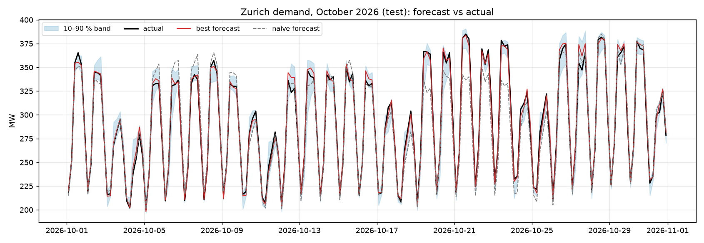

The final model cuts the naive error by about two thirds in every period and is significantly better than plain
LightGBM in all three periods (Diebold–Mariano p = 0.028 in October, §6.3). The largest errors are in the day-time
blocks (§6.3). The weak spots are delivery days two days after a holiday, when the reference day (two days
before delivery) was itself a holiday: there the MAE was 6.60 MW, against 4.55 MW on
normal days (rolling period + October, `reports/model_notes_demand.md`).

### 6.2 Price model

<!-- table:price_metrics -->
| model | Sept MAE (EUR/MWh) | Oct MAE (EUR/MWh) | Oct 95 % CI | Oct RMSE | Oct sMAPE | Oct bias | Oct skill vs naive | Rolling MAE (EUR/MWh) |
|---|---|---|---|---|---|---|---|---|
| Naive (same block 7 days earlier) | 23.54 | 23.47 | 18.36–29.46 | 33.80 | 12.89 % | -19.71 | 0 % | 21.24 |
| Linear (ridge) | 15.16 | 12.77 | 10.57–15.14 | 18.79 | 6.34 % | -7.22 | 46 % | 12.26 |
| Random forest | 19.01 | 16.73 | 14.08–19.85 | 23.03 | 7.99 % | -11.73 | 29 % | 12.12 |
| Gradient boosting (LightGBM) | 16.23 | 16.82 | 14.15–19.83 | 21.86 | 8.08 % | -12.15 | 28 % | 10.17 |
| Best (final model) | 13.62 | 10.99 | 9.02–13.18 | 16.46 | 5.28 % | -6.54 | 53 % | 9.88 |
<!-- /table -->

*MAE in EUR/MWh. Source: `reports/metrics_price.csv`.*

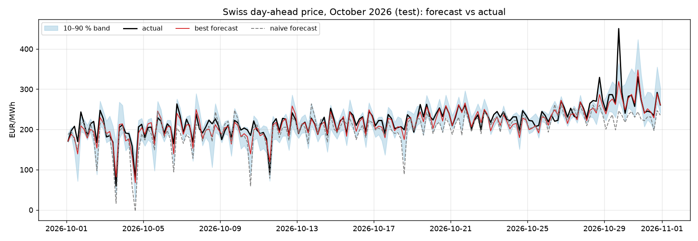

For the battery, the **order** of the blocks inside a day matters more than the level. The decision metrics measure
this:

<!-- table:price_decision -->
| period | model | rank correlation | cheapest block right | dearest block right | shape MAE (EUR/MWh) | day-mean MAE (EUR/MWh) |
|---|---|---|---|---|---|---|
| Oct 2026 | naive | 0.77 | 65 % | 74 % | 14.1 | 20.5 |
| Oct 2026 | gbm | 0.88 | 84 % | 84 % | 8.5 | 15.3 |
| Oct 2026 | best | 0.89 | 84 % | 87 % | 7.4 | 9.0 |
| Oct 2025–Aug 2026 | naive | 0.85 | 84 % | 83 % | 13.3 | 18.4 |
| Oct 2025–Aug 2026 | gbm | 0.91 | 90 % | 87 % | 7.3 | 8.0 |
| Oct 2025–Aug 2026 | best | 0.91 | 88 % | 87 % | 7.4 | 7.6 |
<!-- /table -->

*Rank correlation = Spearman correlation of the six block prices within a day; "cheapest/dearest block right" =
share of days where the model picks the right block; shape MAE = error of (block − day mean); day-mean MAE = error
of the daily level. Source: `reports/decision_metrics_price.csv`.*

**The 10 worst October blocks.**

<!-- table:worst_blocks -->
| day | block | actual | forecast | error | naive | 10–90 % band |
|---|---|---|---|---|---|---|
| 2026-10-29 | 16–20 | 450.6 | 319.1 | -131.5 | 246.2 | 270–364 |
| 2026-10-10 | 12–16 | 185.0 | 139.1 | -46.0 | 59.6 | 87–178 |
| 2026-10-28 | 16–20 | 329.2 | 286.7 | -42.6 | 260.2 | 247–308 |
| 2026-10-01 | 16–20 | 243.4 | 209.0 | -34.5 | 217.4 | 194–231 |
| 2026-10-08 | 12–16 | 213.9 | 181.3 | -32.6 | 169.8 | 106–198 |
| 2026-10-11 | 12–16 | 88.7 | 120.1 | 31.3 | 78.6 | 72–184 |
| 2026-10-01 | 12–16 | 169.8 | 139.1 | -30.7 | 150.8 | 71–150 |
| 2026-10-28 | 12–16 | 270.1 | 240.6 | -29.5 | 244.5 | 212–260 |
| 2026-10-01 | 08–12 | 207.8 | 178.9 | -28.9 | 172.8 | 142–182 |
| 2026-10-26 | 08–12 | 220.3 | 248.9 | 28.6 | 261.9 | 234–271 |
<!-- /table -->

*EUR/MWh; error = forecast − actual. Source: `reports/worst_blocks_price.csv`.*

Eight of the ten worst misses are forecasts that were **too low**, all in day-time and evening blocks. October 2026
prices rose strongly (gas TTF from about 72 EUR/MWh on 30 September to about 97 EUR/MWh on 26 October; the first and
last October closes were 73.94 and 103.94 EUR/MWh, `data/processed/gas_ttf_daily.parquet`), and a model
anchored on today's price follows a trend about one day late; the mean October bias is −6.54 EUR/MWh. The biggest
miss (29 Oct, 16–20, −131.5 EUR/MWh) was a cold, almost wind-still evening in Germany, with a block price far above
anything since 2023. Two misses (10 and 8 Oct) were days when Swiss and German prices diverged: Switzerland did not
follow a German price drop. Full cross-border lines would be one explanation, but that is a guess (we have no
capacity data). There were no negative prices in
October 2026.

### 6.3 Significance, uncertainty and errors per block

<!-- table:dm_tests -->
| target | period | comparison | mean daily MAE difference | DM statistic | p-value | days |
|---|---|---|---|---|---|---|
| demand | Sept 2026 | best vs naive | -5.79 | -4.77 | <0.001 | 30 |
| demand | Sept 2026 | best vs gbm | -0.56 | -3.21 | 0.003 | 30 |
| demand | Oct 2026 | best vs naive | -6.25 | -3.04 | 0.005 | 31 |
| demand | Oct 2026 | best vs gbm | -0.82 | -2.31 | 0.028 | 31 |
| demand | Oct 2025–Aug 2026 | best vs naive | -10.41 | -8.18 | <0.001 | 335 |
| demand | Oct 2025–Aug 2026 | best vs gbm | -0.63 | -3.16 | 0.002 | 335 |
| price | Sept 2026 | best vs naive | -9.92 | -3.52 | 0.001 | 30 |
| price | Sept 2026 | best vs gbm | -2.61 | -3.66 | 0.001 | 30 |
| price | Oct 2026 | best vs naive | -12.47 | -4.23 | <0.001 | 31 |
| price | Oct 2026 | best vs gbm | -5.83 | -4.49 | <0.001 | 31 |
| price | Oct 2025–Aug 2026 | best vs naive | -11.36 | -8.43 | <0.001 | 335 |
| price | Oct 2025–Aug 2026 | best vs gbm | -0.29 | -0.99 | 0.324 | 335 |
<!-- /table -->

*Negative difference = the best model has smaller daily errors. Sources: `reports/model_tests_*.csv`.*

The best price model is clearly better than plain LightGBM in September and October, but **not** over the rolling
11 months (p = 0.324). Its large October gain comes from a month in which the price level moved a lot.

<!-- table:blocks -->
| block | demand best (MW) | demand naive (MW) | price best (EUR/MWh) | price naive (EUR/MWh) |
|---|---|---|---|---|
| 00–04 | 1.34 | 4.30 | 8.93 | 14.47 |
| 04–08 | 1.64 | 6.04 | 9.28 | 16.43 |
| 08–12 | 5.07 | 12.10 | 10.13 | 26.17 |
| 12–16 | 4.60 | 13.70 | 15.43 | 36.43 |
| 16–20 | 4.28 | 12.25 | 15.30 | 30.41 |
| 20–24 | 3.07 | 9.10 | 6.88 | 16.88 |
<!-- /table -->

*October 2026 MAE per block. Source: `reports/metrics_*.csv`.*

<!-- table:bands -->
| target | period | share inside 10–90 % band | mean band width |
|---|---|---|---|
| demand | Sept 2026 | 78 % | 15.9 MW |
| demand | Oct 2026 | 81 % | 15.7 MW |
| demand | Oct 2025–Aug 2026 | 73 % | 19.4 MW |
| price | Sept 2026 | 81 % | 59.4 EUR/MWh |
| price | Oct 2026 | 87 % | 50.4 EUR/MWh |
| price | Oct 2025–Aug 2026 | 78 % | 40.1 EUR/MWh |
<!-- /table -->

*Share of actual values inside the 10–90 % band of the quantile models (target 80 %). Source:
`reports/predictions_*.parquet`.*

### 6.4 What drives demand and price

Permutation importance on September + October 2026 (how much the MAE grows when a group of inputs is shuffled):

<!-- table:importance_demand -->
| group of inputs | MAE increase when shuffled (MW) |
|---|---|
| past demand (all lags) | 47.17 |
| weekday / weekend | 12.33 |
| holidays and school holidays | 9.46 |
| weather (forecast + past observed) | 7.01 |
| season (month, day of year, daylight) | 0.15 |
| Swiss solar (lagged) | 0.01 |
| EVs and charging | 0.00 |
| COVID stringency | 0.00 |
| events and football | -0.01 |
<!-- /table -->

<!-- table:importance_price -->
| group of inputs | MAE increase when shuffled (EUR/MWh) |
|---|---|
| CH price of day D (lags, shape) | 25.05 |
| calendar (block, weekday, holidays, season) | 15.11 |
| Zurich weather (forecast + past observed) | 14.13 |
| European weather forecasts JMA (eu_*_jma) | 2.36 |
| neighbour prices DE/FR/AT/IT (day D) | 1.89 |
| gas / CO2 / EUR-CHF | 1.43 |
| European weather forecasts ICON (eu_*) | 0.75 |
| Zurich demand lags | 0.44 |
| Swiss system D−1 (load, hydro, nuclear, solar) | 0.28 |
| Swiss reservoirs | -0.05 |
<!-- /table -->

One honest sentence per driver the brief asked about (single-LightGBM sensitivity runs from
`reports/experiments_demand.csv`):

- **EVs:** the EV and charging inputs add nothing measurable to the 4-hour forecast (group importance 0.00 MW;
  without them the October MAE was 3.53 instead of 3.63 MW). Their slow growth is already in the recent demand.
- **Weather:** the fourth most important input group (7.01 MW), after past demand, weekday/weekend and holidays;
  without weather the October error rises from 3.63 to 6.49 MW. Solar radiation matters more than temperature in this mild season, and for the price the
  Zurich radiation forecast is the second most important single input (midday solar dip).
- **Solar:** lagged Swiss solar production adds almost nothing to demand (0.013 MW); the solar effect enters through
  the radiation forecast for the delivery day.
- **Holidays:** essential. On the six public holidays outside 24 Dec – 2 Jan the model's error is 4.49 MW against
  52.54 MW for the naive rule; over all ten public holidays it is 5.60 vs 48.32 MW (`reports/model_notes_demand.md`).
  The weak spot is delivery two days after a holiday (6.60 MW), when the reference day was a holiday.
- **Events:** Street Parade, Züri Fäscht, concerts and home games add little incremental predictive value in this
  model (importance −0.01 MW). Without them the single-seed October error was 3.47 instead of 3.63 MW, a difference
  within the seed noise. This says nothing about whether events cause load changes; at 4-hour city level the model
  simply does not need them.

Two more findings: if demand of D−1 were not available at 10:00 (only D−2, as in the public file), the October
error would rise from 3.63 to 4.70 MW. And with observed instead of forecast weather (not achievable) the September
error would fall from 3.29 to 3.01 MW, so the weather forecast error costs about 0.3 MW.

### 6.5 Backtest: the money

<!-- table:test_month_context -->
| month | mean price (EUR/MWh) | mean daily max − min (EUR/MWh) | mean demand (MW) | energy (GWh) | mean EUR/CHF |
|---|---|---|---|---|---|
| Sept 2026 | 168.3 | 143.4 | 284.9 | 205.2 | 0.9433 |
| Oct 2026 | 222.4 | 98.6 | 290.8 | 216.6 | 0.9277 |
<!-- /table -->

*From `data/processed/hourly_actuals.parquet`. October had higher prices but smaller daily spreads than
September.*

**Strategy comparison, October 2026:**

<!-- table:strategies_test -->
| strategy | total cost (CHF) | saving vs 1 (CHF, adj.) | 95 % CI | % of ceiling | battery value (CHF) | imbalance penalty (CHF) | cycles | idle days |
|---|---|---|---|---|---|---|---|---|
| 1 Baseline: naive, no battery | 45,685,820 | 0 | – | 0 % | – | 314,816 | 0.0 | 31 |
| 2 ML demand, no battery | 45,504,787 | 181,033 | 110,713 to 263,228 | 48 % | – | 133,782 | 0.0 | 31 |
| 3 Naive + battery | 45,651,773 | 30,916 | 8,195 to 53,614 | 8 % | 30,916 | 319,773 | 26.3 | 3 |
| 4 ML + battery (product, tuned) | 45,459,321 | 226,499 | 158,868 to 306,077 | 60 % | 45,466 | 133,812 | 30.8 | 0 |
| 4b ML + battery, block plan, defaults | 45,477,016 | 208,022 | 139,322 to 292,420 | 56 % | 26,988 | 134,666 | 22.2 | 0 |
| 5 Perfect foresight, same 4-hour block rules | 45,342,699 | 343,121 | 269,758 to 428,403 | 92 % | 28,305 | 0 | 23.7 | 1 |
| 5b Perfect foresight, hourly, daily reset | 45,315,697 | 370,123 | 297,478 to 456,068 | 99 % | 55,307 | 0 | 30.3 | 0 |
| 6 Perfect foresight, hourly (ceiling) | 45,311,029 | 374,791 | 297,661 to 464,903 | 100 % | 59,975 | 0 | 30.6 | 0 |
| 7 Perfect demand, no battery | 45,371,004 | 314,816 | 240,757 to 403,725 | 84 % | – | 0 | 0.0 | 31 |
<!-- /table -->

*Total cost is raw; "saving vs 1" is inventory-adjusted; CI = 95 % paired bootstrap over days, which treats the days
as independent (a wider interval follows below); battery value = saving against the same strategy without battery
(for 5, 5b and 6: against strategy 7). Imbalance penalty = only the extra 0.2·|p| per MWh of deviation; the full
imbalance settlement of the product (penalty plus the deviation valued at p) is CHF 49,798. Simulation with assumed
imbalance prices and a fictional battery. Source: `reports/backtest_summary.csv`.*

**How wide is the interval really?** Daily savings are not independent: good and bad days come in runs (lag-1
autocorrelation of the product's daily saving 0.57 in October). Re-sampling whole 7-day blocks instead of single days
keeps those runs together and gives a wider interval:

<!-- table:ci_sensitivity -->
| period | product saving vs 1 (CHF) | lag-1 autocorrelation of daily saving | 95 % interval, independent days | 95 % interval, 7-day blocks |
|---|---|---|---|---|
| Oct 2026 (test, 31 days) | 226,499 | 0.57 | 158,868 to 306,077 | 129,685 to 354,460 |
| Sept 2026 (validation, 30 days) | 205,895 | 0.28 | 164,914 to 246,979 | 159,020 to 254,856 |
| Oct 2025–Aug 2026 (rolling, 335 days) | 2,176,783 | 0.64 | 1,954,351 to 2,419,122 | 1,773,743 to 2,624,799 |
<!-- /table -->

*Circular 7-day block bootstrap, 1000 draws, seed 42. Source: `reports/backtest_ci_sensitivity.csv`. We treat the
wider interval as the more honest one: in October the saving is clearly positive, but anywhere between about
CHF 130,000 and CHF 354,000 is plausible.*

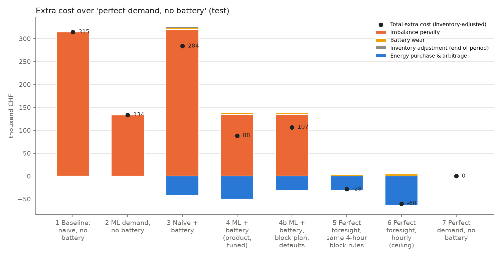

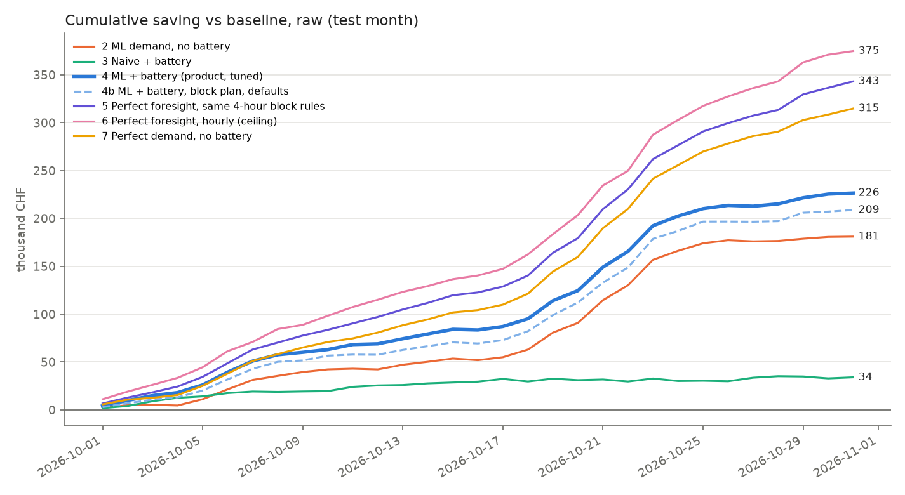

**Where does the saving come from?**

<!-- table:decomposition -->
| period | product saving (CHF) | from better demand forecast | from battery | battery: block plan | battery: hourly shaping + tuning | ceiling saving | % of ceiling | % of ceiling battery value | cost of 4-hour block rule |
|---|---|---|---|---|---|---|---|---|---|
| Oct 2026 (test, 31 days) | 226,499 | 181,033 | 45,466 | 26,988 | 18,477 | 374,791 | 60 % | 76 % | 31,670 |
| Sept 2026 (validation, 30 days) | 205,895 | 119,084 | 86,811 | 67,310 | 19,501 | 314,868 | 65 % | 82 % | 37,313 |
| Oct 2025–Aug 2026 (rolling, 335 days) | 2,176,783 | 1,569,789 | 606,994 | 489,634 | 117,360 | 3,286,831 | 66 % | 84 % | 225,387 |
<!-- /table -->

*"From better demand forecast" = 1 − 2; "from battery" = 2 − 4; split into the plain block plan (2 − 4b) and the
extra from hourly shaping and tuning (4b − 4). "Cost of 4-hour block rule" = battery value of 6 minus that of 5. It
mixes two things, split in the next table. Source: `reports/backtest_decomposition.csv`.*

**What the gap between the block rules (5) and the ceiling (6) is made of:**

<!-- table:block_rule_split -->
| period | battery value, 4-hour blocks, daily reset (5) | battery value, hourly, daily reset (5b) | battery value, hourly, whole period (6) | gap 5 → 6 (CHF) | of which finer dispatch (5 → 5b) | of which inter-day flexibility (5b → 6) |
|---|---|---|---|---|---|---|
| Oct 2026 (test, 31 days) | 28,305 | 55,307 | 59,975 | 31,670 | 27,002 | 4,668 |
| Sept 2026 (validation, 30 days) | 68,483 | 98,997 | 105,796 | 37,313 | 30,513 | 6,800 |
| Oct 2025–Aug 2026 (rolling, 335 days) | 494,577 | 658,487 | 719,964 | 225,387 | 163,910 | 61,477 |
<!-- /table -->

*5 and 5b both return to 20 MWh every evening; 6 plans the whole period at once and may move energy between days.
Source: `reports/backtest_decomposition.csv` (columns `finer_dispatch_part_chf`, `interday_flexibility_part_chf`).*

How to read this:

- **Demand forecast first.** In October the better demand forecast saved CHF 181,033; the battery CHF 45,466.
  The demand saving is exactly the drop in the imbalance penalty (CHF 314,816 with the naive rule, CHF 133,782 with
  ML). The product reaches 60 % of the ceiling. Most of the remaining gap is demand-forecast error that no battery
  can fix: perfect demand alone (7) would reach 84 %.
- **Battery second.** The product's battery captures 76 % of the battery value of the ceiling (CHF 45,466 of
  CHF 59,975). It made 30.8 cycles in 31 days (cycle as defined in §5.3), was never idle, and 98.31 % of the
  offered charge volume cleared (87 of 91 hourly charge bids, 95.60 %).
- **Planning in 4-hour blocks costs a lot of battery value; moving energy between days costs little.** Even with
  perfect foresight, the block rules (5) earn only CHF 28,305 from the battery against CHF 59,975 for the hourly
  ceiling (6): CHF 31,670 less. Most of this, **CHF 27,002, is finer dispatch**: the same perfect foresight with an
  hourly plan that still returns to 20 MWh every evening (5b) earns CHF 55,307. Only **CHF 4,668 is inter-day
  flexibility**, which only the period ceiling has. Our product plans hours inside the blocks (hourly shape) and earns
  more from the battery than the block rules with perfect foresight. Hourly shaping and tuning add CHF 18,477 in
  October over the plain block plan.
- **Exceptions.** The product was cheaper than the baseline on 29 of 31 October days. On the other two days the ML
  demand forecast missed more than the naive one. The ceiling is cheapest over every period, as it must be.

<!-- table:exceptions -->
| period | check that failed on the day | reason | days | period days |
|---|---|---|---|---|
| Oct 2025–Aug 2026 | block_oracle(5) > ml_battery | charge-level carry-over | 2 | 335 |
| Oct 2025–Aug 2026 | block_oracle(5) > ml_battery | hourly prices inside the blocks | 3 | 335 |
| Oct 2025–Aug 2026 | ceiling(6) > ml_battery | inter-day shift | 4 | 335 |
| Oct 2025–Aug 2026 | ml_battery > baseline | battery refill / stock-up | 4 | 335 |
| Oct 2025–Aug 2026 | ml_battery > baseline | demand forecast | 19 | 335 |
| Oct 2025–Aug 2026 | ml_battery > baseline | price forecast | 1 | 335 |
| Oct 2026 | ceiling(6) > ml_battery | inter-day shift | 2 | 31 |
| Oct 2026 | ml_battery > baseline | demand forecast | 2 | 31 |
| Sept 2026 | ceiling(6) > ml_battery | inter-day shift | 2 | 30 |
| Sept 2026 | ml_battery > baseline | demand forecast | 1 | 30 |
<!-- /table -->

*Days on which a check fails although the period total holds. "Inter-day shift": the ceiling plans the whole
period and moves energy between days, so single-day comparisons with it are not meaningful. Source:
`reports/backtest_exceptions.csv`.*

### 6.6 Sensitivities (October, for information only; nothing was chosen from them)

**Battery size.** For the tested two-hour batteries, battery value grows nearly in proportion to size: CHF 1,134 to
1,138 per MWh of capacity per month. We do not have a deeper explanation than our assumption that the battery is a
price taker (its bids never move the price, §8); a real large battery would flatten the price spreads it lives on.

<!-- table:battery_size -->
| battery | product battery value (CHF) | per MWh of capacity (CHF) | block-rule oracle (CHF) | ceiling (CHF) | product total saving vs 1 (CHF) |
|---|---|---|---|---|---|
| 5 MW / 10 MWh | 11,376 | 1,138 | 7,076 | 14,994 | 192,410 |
| 10 MW / 20 MWh | 22,753 | 1,138 | 14,153 | 29,988 | 203,786 |
| 20 MW / 40 MWh | 45,466 | 1,137 | 28,305 | 59,975 | 226,499 |
| 50 MW / 100 MWh | 113,489 | 1,135 | 70,763 | 149,938 | 294,523 |
| 100 MW / 200 MWh | 226,745 | 1,134 | 141,526 | 299,876 | 407,778 |
<!-- /table -->

*Source: `reports/backtest_battery_sensitivity.csv`.*

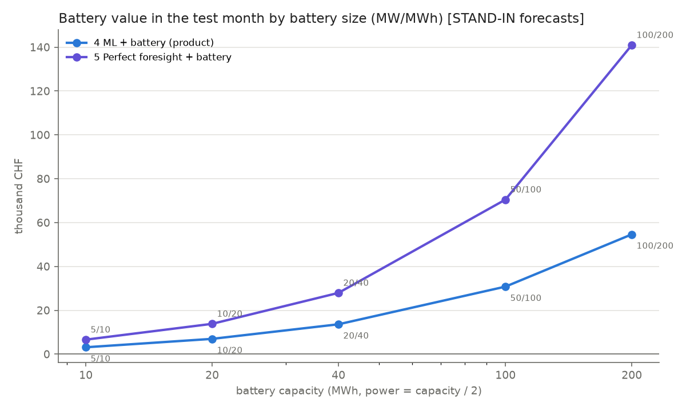

**Price-forecast error.** With perfect demand and the product's rules, we added random errors to the true block
prices. In this experiment the fitted slope is about **CHF 475 of battery saving per month per 1 EUR/MWh of
block-price MAE** (CHF 15 per day). This slope holds for random noise with perfect demand only. Our real ML price
forecast (MAE 11.0) loses only CHF 610 against perfect prices under the same rules, the naive forecast (MAE 23.5) CHF 18,081. The
ML forecast loses less than random noise of the same size, probably because more of its error is in the daily level
(day-mean MAE 9.0) than in the shape (7.4), and the battery needs the shape.

<!-- table:price_error -->
| price forecast | block-price MAE (EUR/MWh) | battery saving lost vs perfect prices (CHF) |
|---|---|---|
| random error, σ = 5 EUR/MWh (mean of 5 seeds) | 3.9 | 374 |
| random error, σ = 10 EUR/MWh (mean of 5 seeds) | 7.7 | 1,966 |
| random error, σ = 20 EUR/MWh (mean of 5 seeds) | 15.9 | 6,659 |
| random error, σ = 30 EUR/MWh (mean of 5 seeds) | 24.7 | 9,312 |
| random error, σ = 45 EUR/MWh (mean of 5 seeds) | 35.1 | 16,716 |
| random error, σ = 60 EUR/MWh (mean of 5 seeds) | 46.3 | 20,799 |
| random error, σ = 80 EUR/MWh (mean of 5 seeds) | 63.2 | 28,765 |
| naive price forecast | 23.5 | 18,081 |
| our ML price forecast | 11.0 | 610 |
<!-- /table -->

*Source: `reports/backtest_price_error_sensitivity.csv`.*

**Imbalance price, charge limit and wear cost.**

<!-- table:decision_sens -->
| what was changed | product saving vs 1 (CHF) | demand forecast part (CHF) | product battery value (CHF) |
|---|---|---|---|
| imbalance factors 1.1/0.9 (shortage/surplus) | 135,998 | 90,517 | 45,481 |
| imbalance factors 1.2/0.8 (shortage/surplus) | 226,499 | 181,033 | 45,466 |
| imbalance factors 1.5/0.5 (shortage/surplus) | 498,004 | 452,584 | 45,420 |
| charge limit factor 0.7 |  |  | 12,315 (charge cleared 21 %) |
| charge limit factor 0.8 |  |  | 43,667 (charge cleared 65 %) |
| charge limit factor 0.9 |  |  | 45,466 (charge cleared 98 %) |
| charge limit factor 1.0 |  |  | 44,909 (charge cleared 100 %) |
| charge limit factor 1.1 |  |  | 44,909 (charge cleared 100 %) |
| charge limit factor none |  |  | 44,909 (charge cleared 100 %) |
| wear cost 0 EUR/MWh |  |  | 49,514 |
| wear cost 2.5 EUR/MWh |  |  | 47,751 |
| wear cost 5 EUR/MWh |  |  | 45,466 |
| wear cost 10 EUR/MWh |  |  | 41,107 |
| wear cost 20 EUR/MWh |  |  | 33,013 |
<!-- /table -->

*Source: `reports/backtest_decision_sensitivity.csv`.*

The value of the demand forecast is **proportional to the assumed imbalance penalty**: CHF 90,517 with factors
1.1/0.9, CHF 452,584 with 1.5/0.5. The battery value hardly moves. Within these assumed multipliers the demand
forecast stays ahead of the battery (about twice the battery even at ±10 %). But real Swissgrid settlement is
quarter-hourly with a single price since 2026, and a deviation in the helpful direction can even earn money. The
multipliers therefore do not prove that the demand forecast is worth more than the battery under real settlement;
that needs real imbalance prices (§10). A charge limit of 0.9 × expected discharge price − wear cost lets 98.31 % of
the offered charge volume clear; a tighter limit (0.7) blocks most charging and destroys most of the value.

### 6.7 Robustness: the rolling year

The same models (refit every month) and the same decision rules were run over every day from October 2025 to
September 2026:

<!-- table:monthly -->
| month | days | saving product vs 1 (CHF) | demand forecast part | battery part | ceiling battery value |
|---|---|---|---|---|---|
| 2025-10 | 31 | 87,246 | 57,216 | 30,029 | 38,403 |
| 2025-11 | 30 | 140,265 | 115,860 | 24,405 | 31,200 |
| 2025-12 | 31 | 153,487 | 143,237 | 10,250 | 16,311 |
| 2026-01 | 31 | 221,621 | 208,142 | 13,479 | 25,155 |
| 2026-02 | 28 | 105,767 | 92,289 | 13,478 | 18,612 |
| 2026-03 | 31 | 139,324 | 89,408 | 49,916 | 59,003 |
| 2026-04 | 30 | 326,827 | 224,148 | 102,680 | 111,641 |
| 2026-05 | 31 | 253,205 | 143,085 | 110,119 | 124,117 |
| 2026-06 | 30 | 245,974 | 168,924 | 77,050 | 92,948 |
| 2026-07 | 31 | 279,895 | 191,137 | 88,757 | 104,149 |
| 2026-08 | 31 | 223,173 | 136,343 | 86,830 | 98,424 |
| 2026-09 | 30 | 205,895 | 119,084 | 86,811 | 105,796 |
| 2026-10 | 31 | 226,499 | 181,033 | 45,466 | 59,975 |
<!-- /table -->

*Raw monthly costs from `reports/backtest.csv` (the battery carries energy over month ends, so single months are
not inventory-adjusted). October 2025 – August 2026 = rolling period; September 2026 = validation; October 2026 =
test.*

The product beat the baseline in every month. The battery earns most from April to September, when solar makes the
midday price drop deep (§4.3), and least from December to February (CHF 10,250 in December 2025). The demand saving
varies between CHF 57,216 and CHF 224,148 per month. Over the rolling period the product captured 66 % of the
ceiling, and its battery 84 % of the ceiling's battery value.

---

## 7. Business value in CHF

**Per month.** In the simulated test month the product saved CHF 226,499 against the simple rule, or 0.50 % of the
baseline's total cost including imbalance (CHF 45,685,820). Of this, CHF 181,033 came from the demand forecast and
CHF 45,466 from the fictional battery. About 80 % of the saving is avoided imbalance penalty at **assumed** prices:
with half the penalty (±10 %) the month would save CHF 135,998 (CHF 90,517 demand + CHF 45,481 battery). Real
Swissgrid settlement (quarter-hourly, single price since 2026) could give a different split, and a deviation can
even help the system there.

**What scales with what.**

| Part of the saving | Grows with | Evidence |
|---|---|---|
| Better demand forecast | the size of the demand error avoided × the imbalance penalty factor × the price level | proportional to the penalty factor (§6.6); varies by month (§6.7) |
| Battery | battery size × the daily price spread × how well the order of hours is forecast | nearly proportional to size under the price-taker assumption (§6.6); high in spring/summer, low in winter (§6.7); about CHF 475 lost per 1 EUR/MWh of random price error with perfect demand (the real ML forecast lost CHF 610) |
| Better price forecast | mainly the battery part | ML vs naive prices: CHF 610 vs CHF 18,081 lost |

**A careful extrapolation to one year.** We do **not** multiply October by 12. October had high prices and
therefore a large imbalance saving, but small daily spreads. Instead we add up the backtest days that already form a
full year, 1 October 2025 to 30 September 2026:

<!-- table:year -->
| basis | product saving (CHF) | demand forecast part | battery part | saving as % of baseline cost | baseline cost (CHF) |
|---|---|---|---|---|---|
| Oct 2025–Sep 2026 = rolling (335 days) + Sept (30 days), 365 days | 2,382,678 | 1,688,874 | 693,805 | 0.80 % | 296,387,119 |
| for comparison only: 12 × October 2026 | 2,717,991 | 2,172,402 | 545,589 | 0.50 % | 548,229,842 |
<!-- /table -->

*The first row adds the rolling period (335 days) and September (30 days) from
`reports/backtest_decomposition.csv`; "baseline cost" is the cost of strategy 1. The second row is shown only to
show how misleading 12 × October would be.*

**Label for this number:** about **CHF 2.4 million per year** (CHF 2,382,678), of which CHF 693,805 from the battery.
It is the **sum over the rolling period (used for tuning the decision rules) plus September (validation) – not an
out-of-sample test**, and it holds only **under the assumed imbalance prices** and with these caveats: the forecasts
are out of sample, but the decision rules were tuned on these same days, and the model settings were chosen on September 2026, which comes after most of these
days (§8). With imbalance factors of 1.1/0.9 instead of 1.2/0.8 the demand part would be roughly halved (§6.6). Whether
the battery part pays for a 40 MWh battery depends on its investment and operating cost, which is outside this project.

---

## 8. Critical evaluation

- **One weather choice saw October weather.** The coefficients of the temperature bias correction are fitted only on
  data before September 2026. But the choice of the correction **method** (month-by-hour offsets vs one linear fit)
  was made by comparing errors on September **and** October 2026 weather (`docs/assumptions_weather.md`). On September
  alone the single linear fit wins by a hair (0.8929 vs 0.8942 °C); with October included the month-by-hour method
  wins (0.9288 vs 0.9407 °C). The two methods differ by about 0.001–0.01 °C, so the effect on the forecasts is tiny,
  and the choice never saw October demand or prices. We did not retrain; we disclose it. All model and decision
  choices were made before October.
- **Observed vs forecast weather.** The full ICON forecast archive starts in January 2024 (coarser JMA forecasts exist
  back to 2018 but were worse as inputs), so training rows before 21 Jan 2024 use observed weather. The model may trust
  weather slightly too much. Validation and test use only forecasts available by 10:00 under the assumed release
  delays, which for most hours means the model run from the day before (October temperature error 0.96 °C,
  `reports/data_checks.md`), so the reported test errors are honest.
- **Assumed imbalance prices.** Shortage at p + 0.2·|p| and surplus at p − 0.2·|p| are assumptions. They explain
  CHF 181,033 of the CHF 226,499 October saving (about 80 %); with ±10 % the saving would be CHF 135,998. Real
  Swissgrid settlement is quarter-hourly with a single imbalance price since 2026, and a deviation that helps the
  system can even earn money there. The demand saving depends directly on this (§6.6); the battery value does not.
  Our numbers therefore do not show that the demand forecast beats the battery under real settlement.
- **Cycle definition.** We keep the brief's rule: one cycle = 32 MWh **delivered** to the grid per day. After
  discharge losses a full swing of the usable stored energy delivers only 30.36 MWh, so the battery may do about 5 %
  more than one physical full cycle. In October it did 30.8 cycles by our definition, which is 32.46 full swings of
  stored energy. A physical cap would lower the October battery saving by about CHF 1,000.
- **Fictional battery.** Size, efficiency, wear cost and limits are assumptions. We assume the battery is a **price
  taker**: its bids do not move the auction price. For 20 MW in a Swiss market this is reasonable; for 100 MW the
  linear scaling in §6.6 is too optimistic.
- **One test month and wide intervals.** October has 31 days; the 95 % interval of the product saving is
  CHF 158,868 to 306,077 if the days were independent. They are not (lag-1 autocorrelation 0.57); a 7-day block
  bootstrap gives CHF 129,685 to 354,460. The rolling year supports the result, but it is not a second clean test.
- **Rules and settings partly chosen with later data.** The decision rules were tuned on the rolling period and
  1–29 September, so those numbers are in-sample for the rules. The model settings (hyper-parameters) were chosen on
  September 2026, after the rolling months. Only October is a fully clean test.
- **ewz status flags.** None of the ewz values is final (W); all are substitute values (E) or unchecked (F). ewz can
  revise values for up to six months. We used them as published.
- **Auction time.** We use 11:00 gate closure and a 10:00 forecast for the whole period. We found no change during
  2019–2026, but single days with delays or decoupling are ignored.
- **Demand availability.** We assume the DSO knows its own demand up to the end of D−1. The public ewz file was about
  1.5 days behind when we downloaded it. Without the D−1 demand the single-LightGBM October error rises from 3.63 to
  4.70 MW (§6.4).
- **Unofficial gas price and data licences.** HSG LSEG/Bloomberg data was not available; gas prices come from Yahoo
  `TTF=F`, which is unofficial and for personal/educational use only. CO₂ uses the official EEX primary auctions as a
  proxy (research use). Processed series derived from both are stored in the repository and the app plots the gas
  series, so the team must check the licences before any public release (README, "Before you publish").
- **Scope of the leakage test.** The automated leakage test cuts and "poisons" the **processed** input tables after
  the forecast time and rebuilds the features; it does not replay from the raw downloads. The raw-to-processed step is
  covered by the loader tests, the data checks and the reviewers' hand checks.
- **No intraday market.** A real DSO would correct forecast errors on the intraday market before delivery, which
  would lower the imbalance cost of all strategies and shrink the demand saving.
- **No grid constraints.** The battery's location and the limits of the city grid are ignored.
- **Block simplification.** Forecasts are per 4-hour block; the hourly shape inside a block is a recent average.
  With perfect foresight the block rules give up CHF 31,670 of battery value in October against the ceiling:
  CHF 27,002 from coarser dispatch and CHF 4,668 from not moving energy between days (§6.5).
- **No cross-border capacity data.** Several large price misses were days when Swiss and German prices diverged.

---

## 9. Ethics and fairness

- **No personal data.** All data is public and aggregated: city-wide load, national prices, weather, yearly car
  counts. No household can be identified.
- **Smart-meter privacy.** If the idea were extended to household smart-meter data (for example for
  neighbourhood forecasts), load curves would reveal when people are at home, sleep or travel. Depending on the
  purpose and the legal basis, this could need the customers' consent; in any case it would need aggregation to
  groups of households, data minimisation and compliance with the Swiss Federal Act on Data Protection.
- **Who benefits.** The savings lower the DSO's purchase cost. Whether customers benefit depends on how tariffs pass
  costs on; for a public utility the fair choice would be to pass them on. Better forecasts also reduce imbalance
  in the national grid, which helps everyone.
- **Energy use of the models.** Training both models takes about 13 minutes of elapsed time on a laptop (8.3 and
  4.7 minutes, model notes). We did not measure the energy use, but a laptop running for 13 minutes is negligible
  next to the 216.6 GWh the city used in October 2026.
- **Transparency.** Every assumption is listed with a reason (`docs/assumptions.md`), the code is reproducible, and
  independent reviews checked each phase (Appendix B).

---

## 10. Next steps

1. **Real imbalance prices** from Swissgrid instead of the 1.2 / 0.8 factors.
2. **An intraday correction** step: re-forecast demand in the morning of D+1 and trade the difference.
3. **Hourly forecasts** instead of 4-hour blocks. With perfect foresight, hourly dispatch is worth CHF 27,002 more
   than block dispatch in October (5 → 5b); our hourly price shape already recovers part of it. Planning several days
   ahead could add at most another CHF 4,668 (5b → 6), so hourly forecasts matter much more than multi-day plans.
4. **Better handling of days after holidays and of price trends** (blend in the level model on such days; add a
   trend-following term for prices).
5. **Cross-border capacity and German renewables forecasts** with verified publication times.
6. **A second test month in winter** (January 2026 is prepared in `config.yaml`).
7. **Official gas and CO₂ data** from LSEG/Bloomberg.
8. **Battery business case:** compare the yearly battery value with the investment and operating cost of different
   sizes.

---

## Appendix A – Reproducibility

```bash
# Python 3.11, from the project folder (macOS: brew install libomp first, for LightGBM)
python3.11 -m venv .venv && .venv/bin/pip install -r requirements.txt
.venv/bin/python -m src.pipeline --all                 # download, features, models, backtest, metrics
.venv/bin/python -m src.pipeline --all --skip-download # rebuild from data/raw/ without internet
.venv/bin/python -m src.pipeline --features --models   # single steps: --data --features --models --backtest --metrics
.venv/bin/python -m pytest                             # 159 tests (loaders, leakage, optimiser, bids, backtest, app)
cd web && bun install && bun run start                 # the app (http://localhost:5173)
.venv/bin/python reports/make_report_tables.py --check reports/report.md   # tables in this report = result files
```

`--all` uses the **frozen** model settings in `models/*.json`. Some steps are separate commands and are not part of
`--all`: the slow variant comparison and hyper-parameter search (`python -m src.models.demand --experiments --tune`,
same for `src.models.price`), the report tables (`python reports/make_report_tables.py --fill reports/report.md`)
and the EDA notebook (`jupyter nbconvert --to notebook --execute --inplace notebooks/01_eda.ipynb`). The project
brief asked to run Python with `-I`; that flag stops `python -m src...` from finding the project package
(ModuleNotFoundError), so the modules are run without `-I` from the project folder.

Random seeds are fixed in `config.yaml`. Notebooks `01_eda` to `04_backtest` show the figures and tables.

## Appendix B – Independent review summary

After every phase a reviewer (a different AI model with a fresh context and read-only access) checked the work.
Confirmed findings were fixed; the rest are documented. Full log: `docs/review_log.md`.

| Phase | Finding | What we did |
|---|---|---|
| 1 Data | Public ewz file lags ~2 days, features use D−1 demand | Kept as an assumption (the DSO reads its own meters); sensitivity run without D−1 demand (§6.4) |
| 1 Data | Reservoir level treated as known from Wednesday 18:00 | **Fixed:** known from Thursday 23:59, first used on Friday |
| 1 Data | EV and charging figures joined by delivery day | **Fixed:** joined as of day D |
| 1 Data | Temperature bias correction fitted up to Aug 2026 and applied to earlier years | Kept, documented: the coefficients are clean for September/October; small look-ahead for the rolling run (error 1.10 → 1.04 °C). Corrected after the final review: the choice of the correction **method** saw September and October weather (see below) |
| 1 Data | Swiss load quality flag uses a centred 7-day window | Kept: a replay of all 2,848 forecast days changed no feature value |
| 2 Features | Observed weather before 21 Jan 2024 | Known limitation; training rows only (§8) |
| 2 Features | COVID index used on the day of announcement | Kept: training rows 2020–2022 only, 0 in validation and test |
| 2 Features | Data dictionary still said Wednesday for reservoirs | **Fixed** |
| 3 Demand | Demand model refit up to 31 Aug / 30 Sep, but demand is only known up to D−1 | **Fixed:** refit up to 30 Aug / 29 Sep; October MAE 3.36 → 3.34 MW |
| 3 Demand | Sensitivity runs ("without weather", "without EVs" …) were scored on October | Kept, stated openly: run after the settings were frozen, never used for a choice |
| 3 Price | The code does not enforce that October is looked at only after all choices | Kept, stated openly; the reviewer found no path from October numbers into the settings |
| 3 Price | The saved model file is one fit; the scored October forecast uses weekly refits | Documented: the single fit alone scores 12.35 EUR/MWh on October instead of 10.99 |
| 3 Price | Some explanations were too confident (bias "halved", "interconnectors were full") | **Fixed** in the notes and in this report |
| 3 Optimiser | The solver tolerance was not exact, so plans could be slightly sub-optimal | **Fixed:** solved with zero optimality gap (`mip_rel_gap = 0`) |
| 4 Backtest | Perfect foresight with block rules (5) was called the upper limit, but it is not a true bound (the product beat it on battery value) | **Fixed:** new ceiling (6) = one hourly perfect-foresight plan over the whole period with matched end level; 5 kept and labelled as block-rule oracle |
| 4 Backtest | The tuning period must end before the first October plan is made | **Fixed:** tuning ends 29 Sept (test start − 2 days, the last day settled by 30 Sept 10:00), enforced in code |
| 4 Backtest | The price-error sensitivity mixed forecast error with the cost of the decision rules | **Fixed:** reference = the same rules with zero noise; the policy gap to the ceiling is reported separately |
| 4 Backtest | Missing price, demand or FX values could be summed as 0 | **Fixed:** the run stops with an error naming the hour; every day must have 23/24/25 hours |
| 4 Bids | In low-load hours the planned discharge could exceed the hour's need, giving a negative demand bid | **Fixed:** discharge is spread with a cap of min(need, power) per hour; block totals are conserved exactly |
| 4 Optimiser | A start level outside the battery limits was accepted | **Fixed:** raises an error |
| 4 Final review | The ceiling is optimised in EUR with a fixed end level but compared in CHF with an inventory credit; optimising exactly the reported figure would lower it by CHF 653 | Kept, documented (0.2 % of the ceiling's saving) |
| 4 Final review | The headline saving depends on the assumed imbalance prices | Stated as the main sensitivity (§6.6, §7) |

### Final review

A last independent reviewer rebuilt the whole project from the raw files on Python 3.11 and reproduced both metric
files, both backtest files, all 154 tests, the leakage suite, the report tables and the notebooks. The findings and
what we did (models and forecasts were **not** retrained; earlier backtest numbers did not change, we only added
outputs):

| Finding | What we did |
|---|---|
| M1 The choice of the temperature-correction method used September **and** October weather; on September alone the other method wins by 0.001 °C | Not retrained (difference 0.001–0.01 °C, no October demand or prices involved). Disclosed in §1, §8, `docs/assumptions.md` and the review log |
| M2 The headline saving needs the imbalance assumption next to it (80 % of it is avoided assumed penalty); the 365-day number is not an out-of-sample test | Caveat added next to every headline number (summary box, §6.6, §7, README, one-pager, slides, app); 365-day number relabelled |
| M3 "4-hour blocks cost CHF 31,670" mixes finer dispatch and moving energy between days | New strategy 5b (hourly perfect foresight, daily reset) and two new columns in `backtest_decomposition.csv`: CHF 27,002 finer dispatch, CHF 4,668 inter-day (§6.5, §10) |
| M4 One cycle = 32 MWh delivered is about 5 % more than one physical full cycle (about CHF 1,000 in October) | Kept the brief's definition; stated in §5.3, §8, the optimiser docstring, the docs and the app |
| M5 The 95 % interval assumes independent days; daily savings are correlated (0.57) | 7-day block bootstrap added (`reports/backtest_ci_sensitivity.csv`): CHF 129,685 to 354,460 in October (§6.5, §8) |
| M6 `--require-ml` could silently drop a day without predictions | **Fixed:** every day of every period must have six finite predictions per target, else the run stops naming the day; new test |
| M7 Yahoo (gas) and EEX data are for personal/research use, and derived series are in the repository | Not changed; "Before you publish" note in README and `app/README.md` (§8) |
| Minor | Charge bids cleared by volume vs count; cost denominator named; holiday cohorts named; weather is the fourth demand driver, solar 0.013 MW, events "little incremental value"; gas trend dated; "prices diverged"; price-error slope qualified; battery size "nearly proportional"; forecast availability wording; app labels "imbalance penalty" with the formula; p-values "<0.001"; consent sentence qualified; training time as elapsed time |
| Brief compliance | Leakage-test scope (processed inputs) stated in §4.4 and §8; separate commands and the `-I` note in Appendix A and the README |

Checked and found correct by the reviewers: local time → UTC conversion of demand incl. all 16 clock-change days,
units, price series, weather time shifts, school-holiday end dates, event dates, 966 hand-recomputed feature values,
all 68,688 hourly actuals, all model metrics and tests (reproduced), and all October costs (recomputed from the
hourly ledger and the raw actuals, matching to the cent); tuning never saw October; the ceiling is the cheapest
strategy in every period.

## Appendix C – Slide outline

The same outline is saved as `reports/slide_outline.md`.

1. **Zurich must buy tomorrow's power by 11:00 today.** TSO → DSO → homes picture; the daily question.
2. **Six blocks, three questions.** How much to buy, how much to store, at what price; timeline 10:00 → 11:00 → D+1.
3. **The team's diagram became working code.** Demand + price + storage → options → optimal blend → bids → settlement.
4. **Clean, correctly timed data.** ewz end labels and clock changes solved; leakage test; what is known at 10:00.
5. **Demand forecast: 3.34 MW error, a third of the naive rule.** Ladder chart and October forecast vs actual.
6. **Price forecast: 10.99 EUR/MWh, and the right order of hours.** Decision metrics; the 29 October spike.
7. **Past demand, the calendar and weather drive demand; EVs and events add little.** Importance chart with one line each.
8. **The battery plan in one picture.** One day: forecast prices, charge at midday, discharge in the evening, option labels.
9. **Simulated October: CHF 226,499 saved, 60 % of the best possible.** Strategy table and cumulative chart; one test
   month, assumed imbalance prices, fictional battery; 95 % interval 129,685 to 354,460 (7-day blocks).
10. **Under assumed imbalance prices, the demand forecast is worth four times the battery.** Decomposition; with half
    the penalty CHF 135,998 in total; not proven for real Swissgrid settlement. Block rules: CHF 27,002 coarser
    dispatch + CHF 4,668 no inter-day shift.
11. **About CHF 2.4 million a year – a backtest sum, not a test.** Rolling period (used for tuning) + September;
    battery size, price error, block rules; limitations.
12. **Next: real imbalance prices, intraday, hourly forecasts.** Ethics in one line: no personal data, savings to customers.
