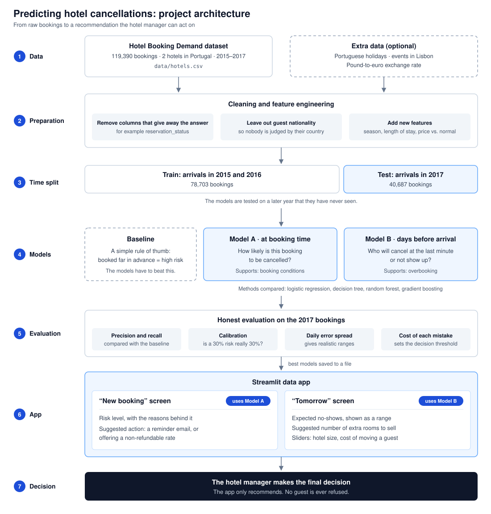

# Workflow

**Project:** Predicting Hotel Cancellations to Protect Revenue

**Goal:** help a hotel manager with two daily decisions: which booking conditions to offer a guest, and how many extra rooms to sell for tomorrow (overbooking).

## Architecture



## Pipeline

Each step builds on the one before it. A step is finished when its "Done when" line is true.

### 1. Load and understand the data

- Load `data/hotels.csv` (119,390 bookings, 32 columns, two hotels in Portugal, arrivals from 2015 to 2017).
- Look at missing values, strange values (for example bookings with zero guests or a negative price) and the cancellation rate per hotel and per year.
- **Output:** `notebooks/01_exploration.ipynb`
- **Done when:** we can explain every column we plan to use and we know how many rows we drop and why.

### 2. Clean the data and build features

- **Remove columns that give away the answer.** These only get their final value after the outcome is known: `reservation_status`, `reservation_status_date`, `assigned_room_type`, `booking_changes`.
- **Leave out `country`.** We don't want the model to judge guests by nationality.
- **Add new features:**
  - season and weekday of arrival, and whether the stay includes a weekend
  - total length of stay and total number of guests
  - price per person, and price compared with the normal price for that month and room type
  - how many bookings already existed for the same arrival date (count only bookings made earlier)
- **Optional extra data:** Portuguese public holidays, big events in Lisbon, pound-to-euro exchange rate.
- **Output:** `notebooks/02_features.ipynb` and a cleaned file in `data/`
- **Done when:** every feature uses only information the hotel has at the moment of the prediction.

### 3. Split by time

- **Train:** arrivals in 2015 and 2016 (78,703 bookings).
- **Test:** arrivals in 2017 (40,687 bookings).
- We never shuffle the years together. The test has to be a future the model hasn't seen.

### 4. Build the models

| | Model A | Model B |
|---|---|---|
| **When** | At booking time | 7 days before arrival |
| **Question** | How likely is this booking to be cancelled? | Among guests still booked, who will cancel at the last minute or not show up? |
| **Decision** | Which booking conditions to offer | How many extra rooms to sell |

- **Baseline:** a simple rule of thumb ("booked far in advance = high risk"). Both models have to beat it.
- **Methods to compare:** logistic regression, decision tree, random forest, gradient boosting.
- For Model B we use `reservation_status_date` only to build the target (did the guest cancel in the last days?). It is never an input.
- **Output:** `notebooks/03_model_a.ipynb`, `notebooks/04_model_b.ipynb`
- **Done when:** each model has a score on the 2017 test data next to the baseline's score.

### 5. Evaluate honestly

- **Precision and recall** for each model, compared with the baseline.
- **Calibration:** when the model says 30% risk, do about 30% of those bookings really cancel?
- **Daily error spread:** for each day in 2017, compare predicted and actual cancellations. Cancellations are not independent (groups, strikes, weather), so we measure the real spread and show ranges in the app.
- **Cost of mistakes:** put a price on an empty room and on moving a guest to another hotel, and choose the decision threshold that costs the least.
- **With and without the extra data:** check whether holidays, events and exchange rates really improve the model. If they don't, we say so.
- **Output:** `notebooks/05_evaluation.ipynb`
- **Done when:** we have one slide called "Where our model can go wrong".

### 6. Build the app

- Built with Streamlit, like the app from Lecture 5. The trained models are saved to `models/` and loaded by the app.
- **"New booking" screen (Model A):** the manager enters a booking and sees the risk level, the reasons behind it and a suggested action (a reminder email, or offering a non-refundable rate).
- **"Tomorrow" screen (Model B):** shows the expected number of no-shows as a range and suggests how many extra rooms to sell. Sliders set the hotel's size and the cost of moving a guest.
- The app only recommends. No guest is ever refused, and the manager makes the final decision.
- **Output:** `app/app.py`
- **Done when:** someone outside the team can use both screens without an explanation.

### 7. Prepare the presentation

- Tell the story for a non-technical audience: problem, data, approach, results, limits, app demo.
- **Output:** slides in `docs/`

## Folder structure

Only `data/`, `docs/` and `workflow.md` exist so far. The other folders get created as we reach each step.

```
grouproject/
├── data/           hotels.csv and cleaned data
├── docs/           architecture.svg, proposal, slides
├── notebooks/      one notebook per pipeline step (01 to 05)
├── models/         saved models for the app
├── app/            Streamlit app
├── requirements.txt
└── workflow.md     this file
```

## Team and roles

| Name | Responsible for |
|------|-----------------|
|      |                 |
|      |                 |
|      |                 |

## Timeline

| Deadline | Milestone | Owner | Status |
|----------|-----------|-------|--------|
|          | Proposal handed in |  |  |
|          | Steps 1 and 2: data explored and cleaned |  |  |
|          | Steps 3 and 4: both models trained |  |  |
|          | Step 5: evaluation finished |  |  |
|          | Step 6: app working |  |  |
|          | Step 7: presentation ready |  |  |

## Working together with git

- Run `git pull` before you start working, so you have everyone's latest changes.
- Make small commits with a message that says what changed.
- Two people should not edit the same notebook at the same time. Notebooks are hard to merge.
- Clear notebook outputs before committing if they are very large.
- Don't commit your Python environment folder or files bigger than 50 MB.

## Decisions so far

| Decision | Reason |
|----------|--------|
| Two models (at booking time, and a few days before arrival) | Each one supports a different decision. |
| Train on 2015 and 2016, test on 2017 | An honest test of whether the past predicts the future. |
| Remove columns that give away the answer | Otherwise the model looks better than it would be in real use. |
| Leave out `country` | Treating guests differently by nationality is unfair. |
| Never refuse a guest, only soft actions | An 80% risk still means 1 in 5 of those guests would have come. |
| Show ranges for overbooking, based on the measured daily spread | Cancellations happen together, so a single number hides the risk. |
| The manager always decides | The model can't know about one-off events. |
| Model B predicts 7 days before arrival | Matches the "last week" figure in the proposal. |
| One model for both hotels, with hotel type as an input | More training data, and the model can still treat the hotels differently. |
| Empty room = price of the night; moving a guest = 2 × price (assumption) | Sets the overbooking rule. Details in `business_model.md`. |

## Open questions

- Which extra data do we add: holidays, events, exchange rate, or none?
- A source for the "2 × price" cost of moving a guest, or we keep it as a stated assumption.
- How many rooms does each hotel have? Needed to simulate 2017.
- Who does what, and what are the deadlines? (Fill in the two tables above.)
